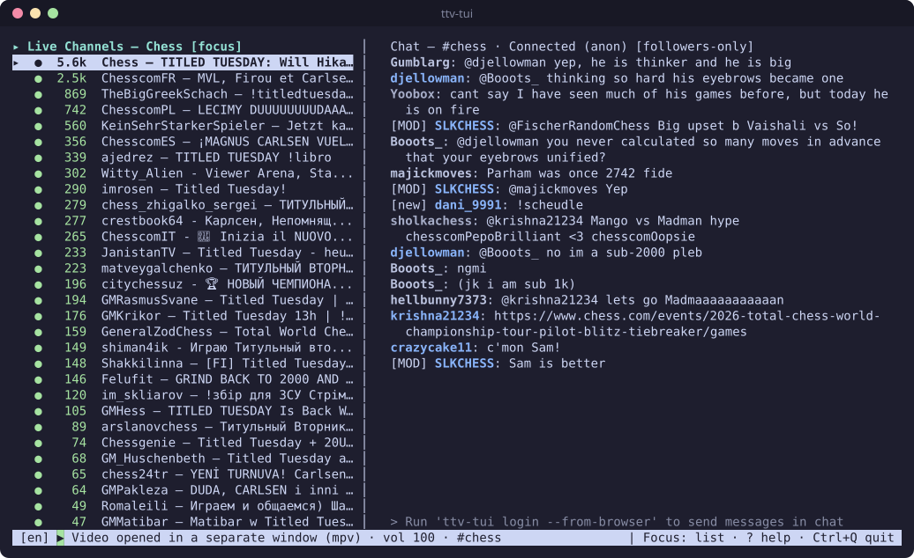
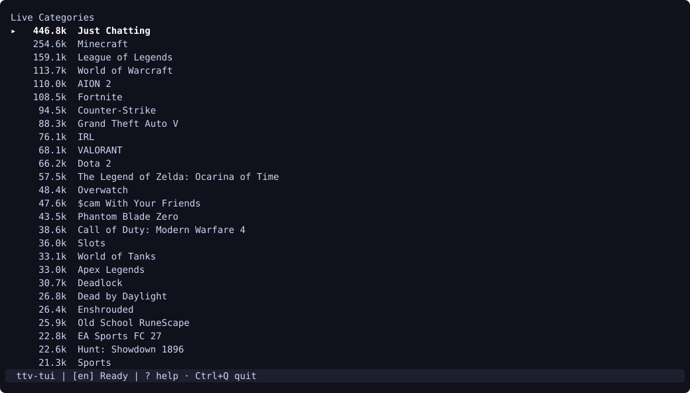
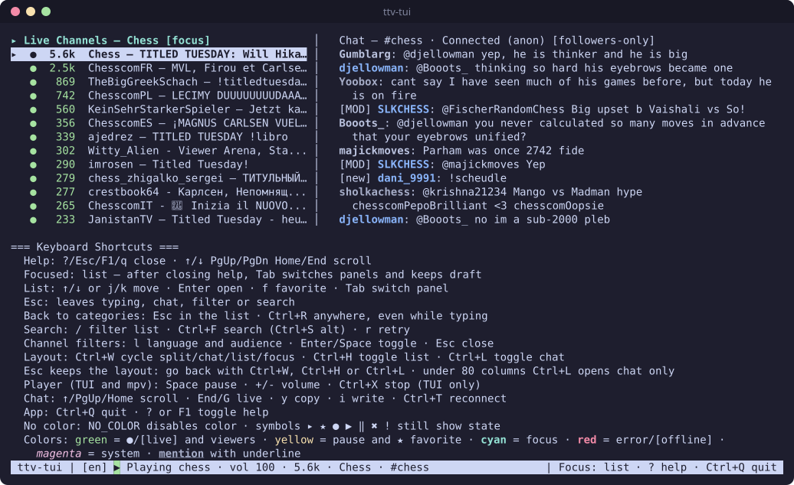

# ttv-tui

[](https://github.com/pedrosatin/ttv-tui/actions/workflows/ci.yml)

[Português (Brasil)](docs/README.pt-BR.md)

Twitch in your terminal. Browse live categories and channels, watch a stream and chat, without opening a browser. Video plays through `streamlink` and `mpv`, with ad segments filtered out. You don't need an account to watch or read chat.



<details>
<summary>More screenshots</summary>

Live categories, the first screen:



Shortcut help, opened with `?`:



</details>

## Install

You need `streamlink` and `mpv` in your `PATH` to play video. The [FAQ](#faq) has the install command for each system.

**Linux and macOS.** The script verifies the SHA-256 checksum and installs to `~/.local/bin`:

```bash
curl -fsSL https://raw.githubusercontent.com/pedrosatin/ttv-tui/main/packaging/install.sh | bash
```

**Windows x64.** From a checkout, in PowerShell:

```powershell
.\packaging\install.ps1 -Version 0.9.0
winget install --id shinchiro.mpv -e
winget install --id streamlink.streamlink -e
```

<details>
<summary>Other ways to install</summary>

**Release archive.** Download the archive for your OS and `checksums.txt` from the [v0.9.0 release](https://github.com/pedrosatin/ttv-tui/releases/tag/v0.9.0). Check the SHA-256 with `sha256sum`, `shasum -a 256` or `Get-FileHash -Algorithm SHA256`, then put `ttv-tui` in your `PATH`.

**Go 1.27 or newer:**

```bash
go install github.com/pedrosatin/ttv-tui/cmd/ttv-tui@v0.9.0
```

**Arch Linux.** The AUR package is not published yet. Build it from the PKGBUILD:

```bash
cd packaging && makepkg -si
```

**From source:**

```bash
git clone https://github.com/pedrosatin/ttv-tui.git && cd ttv-tui
CGO_ENABLED=0 go build -o ~/.local/bin/ttv-tui ./cmd/ttv-tui
```

**Homebrew and Scoop.** The [formula](packaging/homebrew/README.md) and the [Scoop manifest](packaging/scoop/ttv-tui.json) are ready but not published yet.

**Install script options.** Pass a version such as `install.sh 0.9.0`, preview with `--dry-run`, or change the target with `--prefix`. On Windows, `install.ps1 -DryRun` previews the plan.

**Desktop shortcut.** `install.sh` and the PKGBUILD install the desktop entry and the icon. After `go install` or `go build`, copy them yourself:

```bash
install -Dm644 packaging/ttv-tui.desktop ~/.local/share/applications/ttv-tui.desktop
install -Dm644 assets/ttv-tui.svg ~/.local/share/icons/hicolor/scalable/apps/ttv-tui.svg
```

</details>

## Use

```bash
ttv-tui                     # browse and watch, no account needed
ttv-tui login --import twt  # optional: reuse your twitch-tui token to send chat messages
ttv-tui doctor              # check dependencies, paths and token presence
```

Pick a category with `Enter`, then a channel with `Enter`. The stream starts and its chat opens on the right. Press `?` for the shortcut list.

## Platforms

| OS | Release build | CI tests | Tested by hand |
| --- | --- | --- | --- |
| Linux amd64 | Yes | Yes | Yes, on Arch Linux with Wayland |
| Linux arm64 | Yes | No | No |
| macOS arm64 (Apple Silicon) | Yes | Yes | No |
| Windows x64 | Yes | Yes | No |
| macOS Intel, Windows ARM | Yes, experimental | No | No |

> [!WARNING]
> Only Linux amd64 has been tested by hand. On macOS and Windows the code builds and the automated tests pass, but nobody has checked video, audio, login, the clipboard or shutdown on a real machine. The dependency commands for those systems and for Debian/Ubuntu were not run either. Reports are welcome in the [issues](https://github.com/pedrosatin/ttv-tui/issues).

The split view needs 80 columns. Below that, the app shows chat only or the list only.

## Keyboard shortcuts

<details open>
<summary>List and search</summary>

| Key | Action |
| --- | --- |
| `↑` `↓` or `j` `k` | Move the selection |
| `Enter` | Open the category or watch the channel |
| `f` | Add or remove the channel from favorites |
| `/` | Filter the current list |
| `Ctrl+F` or `Ctrl+S` | Search channels across Twitch |
| `l` | Filter channels by language and audience |
| `r` | Retry loading the list or the video |
| `Esc` | Clear the filter, or go back to categories |
| `Ctrl+R` | Go back to categories from anywhere |
| `Tab` | Move focus between the list and the chat |

</details>

<details open>
<summary>Chat</summary>

| Key | Action |
| --- | --- |
| `i` | Write a message |
| `Enter` | Send the message |
| `Esc` | Stop writing and keep the draft |
| `↑` `↓` `PgUp` `Home` | Scroll the history |
| `End` or `G` | Back to live messages |
| `y` | Copy the selected message |
| `Ctrl+T` | Reconnect to the chat |

</details>

<details open>
<summary>Video, layout and app</summary>

| Key | Action |
| --- | --- |
| `Space` | Pause or resume |
| `+` `-` | Volume up or down by 5% |
| `Ctrl+X` | Stop the video and stay in the app |
| `Ctrl+W` | Cycle layouts: list + chat, chat, list, none |
| `Ctrl+H` / `Ctrl+L` | Show or hide the list / the chat |
| `?` or `F1` | Show or hide the shortcut help |
| `Ctrl+Q` | Quit |

`Space` and `+` `-` also work in the `mpv` window. Its other keys do nothing.

</details>

<details>
<summary>Single window only</summary>

| Key | Action |
| --- | --- |
| `Ctrl+→` / `Ctrl+←` | Widen / narrow the list |
| `Alt+←` / `Alt+→` | Widen / narrow the chat |
| `Ctrl+O` | Put the chat beside the video or over it |
| `Alt+↑` / `Alt+↓` | Raise / lower the opacity of the chat over the video |
| `Ctrl+P` | Swap the sides of the list and the chat |

The app saves these choices in `config.toml`.

</details>

## FAQ

<details>
<summary><b>How does it work?</b></summary>

The app ties three tools together and draws the interface around them:

1. **Lists.** Categories, channels and search come from the public GraphQL API that twitch.tv itself uses. The app registers no Twitch application.
2. **Video.** When you open a channel, the app starts `streamlink`. It fetches the stream at the best quality, drops the ad segments and pipes the video to `mpv`. The app sends pause, volume and stop to `mpv` over a local JSON IPC socket.
3. **Chat.** The chat connects to Twitch IRC over TLS. Without a token it logs in anonymously and only reads.

The app plays one channel at a time. Opening another channel stops the old player and moves the chat to the new room. Each channel keeps its own message draft until you quit; switching never sends it, and going back brings it back. `Ctrl+X` stops only the video, and the chat stays open. `Ctrl+Q` stops `streamlink` and `mpv`, removes the temporary IPC files and disconnects the chat.

The [ADRs](docs/adr/) explain each choice.

</details>

<details>
<summary><b>How do I install the dependencies?</b></summary>

`streamlink` and `mpv` are required for video. `sqlite3` and `secret-tool` matter only for `login --from-browser`.

| System | Command |
| --- | --- |
| Arch Linux | `sudo pacman -S streamlink mpv sqlite libsecret` |
| Debian / Ubuntu | `sudo apt install streamlink mpv sqlite3 libsecret-tools` |
| macOS | `brew install mpv streamlink` |
| Windows (winget) | `winget install --id shinchiro.mpv -e` and `winget install --id streamlink.streamlink -e` |
| Windows (Scoop) | `scoop bucket add extras` and `scoop install extras/mpv extras/streamlink` |

Only the Arch command was tested. If your distribution ships an old `streamlink`, install a current one with `pipx install streamlink`.

The single window on Linux also needs SDL3 and libmpv. On Arch, that is `sudo pacman -S sdl3 mpv`.

Run `ttv-tui doctor` afterwards. It lists what is missing.

</details>

<details>
<summary><b>How do favorites and recent channels work?</b></summary>

Press `f` on a channel to add it to favorites, and press it again to remove it. Every channel you open goes to the recent list, which keeps the last 50. Both sections sit at the top of the list.

In a new session, those channels show `[unverified]` until you open them or they show up in a live list. They are stored in `state.json`, not on your Twitch account.

</details>

<details>
<summary><b>Do I need a Twitch account?</b></summary>

No. Browsing, watching and reading chat work anonymously. You need a token only to send chat messages.

</details>

<details>
<summary><b>How do I log in to send messages?</b></summary>

Pick one:

- `ttv-tui login --import twt` copies the token from [twitch-tui](https://github.com/Xithrius/twitch-tui). It is a chat-scoped token, so prefer this one.
- `ttv-tui login --from-browser` copies the `auth-token` cookie from Brave, Chrome, Chromium, Edge, Vivaldi, Opera or Firefox. Add `--browser` and `--profile` to skip the prompt. It works on Linux only for now, and it needs `sqlite3`. Chromium-based browsers also need `secret-tool`, from `libsecret`.

</details>

<details>
<summary><b>Is <code>--from-browser</code> safe?</b></summary>

Know what it reaches before you use it:

- The `auth-token` cookie is a full session for your Twitch account, not a chat-only token.
- To decrypt it in Chromium-based browsers, the app reads the browser key from your keyring. That key can decrypt every cookie in that browser. The app reads only the Twitch row and drops the key when `login` ends.
- The token is saved in plain text in `config.toml`, with mode `0600` on Linux and macOS. The app never prints it.

[SECURITY.md](SECURITY.md) has the full details.

</details>

<details>
<summary><b>How do I log out or revoke the token?</b></summary>

Deleting the local file does not end the session on Twitch. Do both:

1. On twitch.tv, open **Settings → Security and Privacy → Sign Out Everywhere**. For an imported `twt` token, you can also revoke it under **Settings → Connections**.
2. Delete `config.toml`. `ttv-tui doctor` shows where it is. On Linux:

   ```bash
   rm -f "${XDG_CONFIG_HOME:-$HOME/.config}/ttv-tui/config.toml"
   ```

</details>

<details>
<summary><b>Does it block ads?</b></summary>

`streamlink` drops the ad segments from the stream. During an ad break, the status bar shows `Ad break: the video resumes on its own` with a countdown.

</details>

<details>
<summary><b>Why does the video open in another window?</b></summary>

The app does not decode video. `mpv` plays it in its own window, and the app controls it over IPC. The `mpv` window has no controls. Use the app's keys, and close the video with `Ctrl+X` or by closing the window.

When `ttv-tui-window` sits next to `ttv-tui` and can open a window, the app opens a single window instead, with the list, the video and the chat side by side. It needs SDL3 and libmpv. On Linux amd64 the install script adds `ttv-tui-window` for you; it was tested by hand on Wayland, not on X11. On Windows x64, `install.ps1` adds it in a `ttv-tui-window` folder with its DLLs; a proof of concept worked on Windows 11. On macOS you build it from source, and nobody has tried it there. To stay in the terminal, run `ttv-tui --terminal`. Color emoji show as empty boxes in that window for now. See [ADR 0011](docs/adr/0011-janela-unica.md) and [ADR 0012](docs/adr/0012-janela-unica-multiplataforma.md).

</details>

<details>
<summary><b>Where did the chat go?</b></summary>

Your terminal is narrower than 80 columns, so the split view hides the chat. Press `Ctrl+L` to see the chat at full width, or widen the terminal.

</details>

<details>
<summary><b>What do <code>[sending]</code>, <code>[rejected]</code> and the other chat tags mean?</b></summary>

| Tag | Meaning |
| --- | --- |
| `[sending]` / `[sent]` | Waiting for the server / the server confirmed the message |
| `[rejected: <reason>]` | Not sent. The reason can be slow mode, followers-only, subs-only, emote-only, a duplicate message, a ban, or no answer from the server |
| `[discarded: …]` | The message hit Twitch's limit of 20 messages per 30 seconds, or you switched channels before it went out |
| `[new]` | Message from a new account |
| `[deleted]` | A moderator deleted the message. You can still read and copy it |

Messages sent less than 1 second apart wait in a queue. Slash commands are blocked, except `/me`, and your draft stays.

</details>

<details>
<summary><b>Can I ban, time out or delete messages?</b></summary>

No. Twitch removed moderation commands from IRC, so `/ban` would go out as a public message. Moderation needs the Helix API and a registered Twitch app, which this project does not use.

</details>

<details>
<summary><b>Does it show emotes, VODs or my followed channels?</b></summary>

Not yet:

- Emotes show as text. Twitch, BTTV and 7TV images are not drawn.
- Only live streams play. VODs and clips do not.
- Favorites and recent channels do not sync with the channels you follow on Twitch.

</details>

<details>
<summary><b>Where does the app keep its files?</b></summary>

| OS | Config and token | Favorites and recents |
| --- | --- | --- |
| Linux | `~/.config/ttv-tui/config.toml` | `~/.local/state/ttv-tui/state.json` |
| macOS | `~/Library/Application Support/ttv-tui/config.toml` | `~/Library/Application Support/ttv-tui/state/state.json` |
| Windows | `%APPDATA%\ttv-tui\config.toml` | `%LOCALAPPDATA%\ttv-tui\state.json` |

`XDG_CONFIG_HOME` and `XDG_STATE_HOME` override these paths on every OS. If `state.json` is corrupted, the app saves it as `state.json.bak` and starts with empty lists.

</details>

<details>
<summary><b>The video does not play, or there is no sound</b></summary>

1. Run `ttv-tui doctor`. It reports missing `streamlink` or `mpv`, the paths in use and whether a token exists, without showing it.
2. `Player error: channel offline` means the stream ended. Pick another channel, or press `r` to retry.
3. Check that the status bar does not show `vol 0`. Press `+` to raise the volume.
4. On Linux, check that `WAYLAND_DISPLAY` or `DISPLAY` is set and that an audio server is running.
5. Press `?` after a failure to read the last error from `streamlink` or `mpv`.

</details>

<details>
<summary><b>The app asks to stop "a player from a previous session"</b></summary>

A previous run was killed before it could close `streamlink` and `mpv`. Answer `Y` to stop the leftover player.

</details>

<details>
<summary><b>How do I change the language or turn off colors?</b></summary>

Pass `--lang en` or `--lang pt-BR`, or set `language` in `config.toml`. Without either, the app follows your `LANG` and falls back to English.

To turn off colors, run with `NO_COLOR=1`. The symbols `▸ ★ ● ▶ ‖ ✖` still show the state.

</details>

<details>
<summary><b>Where does <code>y</code> copy to?</b></summary>

Inside tmux, the app tries the tmux buffer first. Then it tries `wl-copy`, `xclip` and OSC 52, in that order. The status bar names the one that worked. Inside tmux, OSC 52 needs `set-clipboard on`. The copy includes the channel and time, for example `channel #login · 2026-11-10 14:30 · nick: text`.

</details>

<details>
<summary><b>Why doesn't <code>Ctrl+C</code> quit? Won't <code>Ctrl+S</code> freeze my terminal?</b></summary>

Quit with `Ctrl+Q`, which works even while you type. `Ctrl+C` only shows the hint `To quit use Ctrl+Q`.

The app runs the terminal in raw mode, so the terminal sends `Ctrl+S` and `Ctrl+Q` to the app instead of pausing output.

</details>

## Development

<details>
<summary>Build, test and lint</summary>

These are the CI checks:

```bash
TMPDIR=/tmp go build ./...
TMPDIR=/tmp go vet ./...
TMPDIR=/tmp go test -count=1 ./...
TMPDIR=/tmp go test -race -count=1 ./internal/player ./internal/chat ./internal/ui ./internal/store
TMPDIR=/tmp go run github.com/golangci/golangci-lint/v2/cmd/golangci-lint@v2.15.0 run
```

`TMPDIR=/tmp` keeps the test socket paths under the 108-byte Unix limit.

The design decisions are in [`docs/adr/`](docs/adr/).

</details>

## License

MIT. See [LICENSE](LICENSE).
