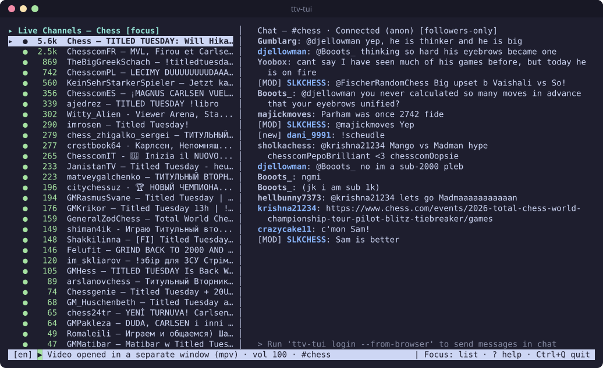
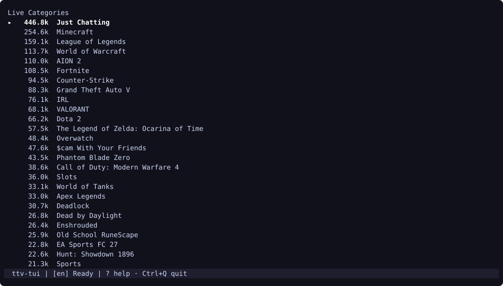
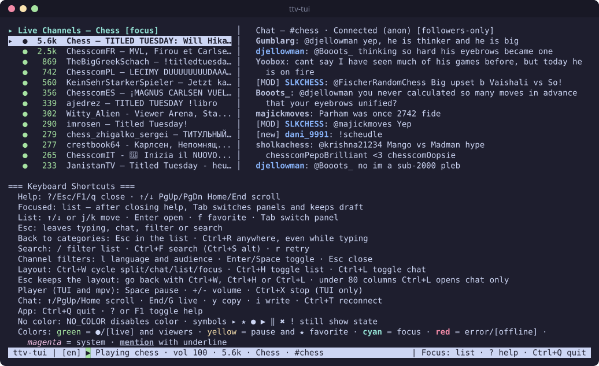

# ttv-tui

[](https://github.com/pedrosatin/ttv-tui/actions/workflows/ci.yml)

[Português (Brasil)](docs/README.pt-BR.md)

Twitch in your terminal. Browse live categories and channels, watch a stream and chat, without opening a browser. Video plays through `streamlink` and `mpv`, with ad segments filtered out. You don't need an account to watch or read chat.



<details>
<summary>More screenshots</summary>

Live categories, the first screen:



Shortcut help, opened with `?`:



</details>

## Install

You need `streamlink` and `mpv` to play video. On Linux and Windows, `streamlink` is downloaded automatically on first playback if missing. On Windows, the single window plays video without `mpv`; only the terminal mode needs it. The [FAQ](#faq) has the install command for each system.

**Linux and macOS.** The script installs the latest release, verifies the SHA-256 checksum, checks the GitHub build provenance attestation when `gh` is on `PATH` (and warns when it is not), then installs to `~/.local/bin`. When `gh` is present it must be authenticated (`gh auth login`); without a login the installer fails closed:

```bash
curl -fsSL https://raw.githubusercontent.com/pedrosatin/ttv-tui/main/packaging/install.sh | bash
```

**Windows x64.** From a checkout, in PowerShell. The script installs the latest release, verifies the SHA-256 checksum, and checks the GitHub build provenance attestation when `gh` is on `PATH` (authenticated; fails closed without a login):

```powershell
.\packaging\install.ps1
winget install --id shinchiro.mpv -e
winget install --id streamlink.streamlink -e
```

<details>
<summary>Other ways to install</summary>

**Release archive.** Download the archive for your OS and `checksums.txt` from the [latest release](https://github.com/pedrosatin/ttv-tui/releases/latest). Check the SHA-256 with `sha256sum`, `shasum -a 256` or `Get-FileHash -Algorithm SHA256`. With the [GitHub CLI](https://cli.github.com/) installed and authenticated (`gh auth login`), also verify build provenance against the release workflow:

```bash
gh attestation verify ttv-tui_<version>_<os>_<arch>.tar.gz \
  --repo pedrosatin/ttv-tui \
  --signer-workflow pedrosatin/ttv-tui/.github/workflows/release.yml
```

Then put `ttv-tui` in your `PATH`.

**Go 1.27 or newer:**

```bash
go install github.com/pedrosatin/ttv-tui/cmd/ttv-tui@latest
```

**Arch Linux.** The AUR package is not published yet. Build it from the PKGBUILD:

```bash
cd packaging && makepkg -si
```

**From source:**

```bash
git clone https://github.com/pedrosatin/ttv-tui.git && cd ttv-tui
CGO_ENABLED=0 go build -o ~/.local/bin/ttv-tui ./cmd/ttv-tui
```

**Homebrew:**

```bash
brew install pedrosatin/tap/ttv-tui
```

**Scoop:**

```powershell
scoop bucket add pedrosatin https://github.com/pedrosatin/scoop-bucket.git
scoop install pedrosatin/ttv-tui
```

Details: [Homebrew](packaging/homebrew/README.md), [Scoop](packaging/scoop/README.md).

**Install script options.** Without arguments the scripts install the latest release. To pin a version, pass it as an argument: `install.sh 0.10.2` or `install.ps1 -Version 0.10.2`. These version numbers are only an example; pick one from the [releases](https://github.com/pedrosatin/ttv-tui/releases). Preview with `--dry-run`, or change the target with `--prefix`. On Windows, `install.ps1 -DryRun` previews the plan.

**Desktop shortcut.** `install.sh` installs the desktop entry and icon only from the checksum-verified release tarball. If the tarball lacks either file, as releases up to v0.1.7 do, it warns and installs neither. The PKGBUILD also installs them. After `go install` or `go build`, copy them yourself:

```bash
install -Dm644 packaging/ttv-tui.desktop ~/.local/share/applications/ttv-tui.desktop
install -Dm644 assets/ttv-tui.svg ~/.local/share/icons/hicolor/scalable/apps/ttv-tui.svg
```

</details>

## Use

```bash
ttv-tui                     # browse and watch, no account needed
ttv-tui login --import twt  # optional: reuse your twitch-tui token to send chat messages
ttv-tui doctor              # check dependencies, paths and token presence
```

Pick a category with `Enter`, then a channel with `Enter`. The list opens on Twitch; `p` switches it to Kick and back. You can also press `Ctrl+F` (or `/` when nothing in the list matches) and paste a stream URL (Twitch, Kick, YouTube) to play directly. The stream starts and its chat opens on the right: Twitch, Kick and YouTube have chat, and the Kick and YouTube ones are read-only. Typing `@channel` searches the platform the list shows, since `@name` is how people call each other on Twitch and Kick; the last row of the results offers to open `@channel` on YouTube. Press `?` for the shortcut list.

## Platforms

| OS | Release build | CI tests | Tested by hand |
| --- | --- | --- | --- |
| Linux amd64 | Yes | Yes | Yes, on Arch Linux with Wayland |
| Linux arm64 | Yes | No | No |
| macOS arm64 (Apple Silicon) | Yes | Yes | No |
| Windows x64 | Yes | Yes | No |
| macOS Intel, Windows ARM | Yes, experimental | No | No |

> [!WARNING]
> Only Linux amd64 has been tested by hand. On macOS and Windows the code builds and the automated tests pass, but nobody has checked video, audio, login, the clipboard or shutdown on a real machine. The dependency commands for those systems and for Debian/Ubuntu were not run either. Reports are welcome in the [issues](https://github.com/pedrosatin/ttv-tui/issues).

The split view needs 80 columns. Below that, the app shows chat only or the list only.

## Keyboard shortcuts

Ctrl+W is a prefix: press h/l to toggle the left/right panel, o for overlay, x to swap sides, w to cycle layouts, +/- for chat height, and </> for chat width. A popup appears after a short pause; the sequence works immediately. Esc cancels. Ctrl+B also toggles the list in the window; terminal users keep their tmux prefix. Use g f for favorites, g r for recents and g g for the top. Existing configurations receive one migration notice. Ctrl+O still puts the chat over the video, next to Ctrl+W o. Set `keymap = "classic"` in your config to restore the previous keys, including Ctrl+H/L/P, Ctrl+W cycling, lowercase l, g (Home) and Ctrl+S search.

<details open>
<summary>List and search</summary>

| Key | Action |
| --- | --- |
| `↑` `↓` or `j` `k` | Move the selection |
| `PgUp` `PgDn` | Move one screen |
| `Home` / `g g`, `End` / `G` | First or last loaded item |
| `Enter` | Open the category or watch the channel |
| `f` | Favorite a channel or pin a category; press again to remove |
| `x` | Remove the highlighted channel from recents |
| `X` | Clear every recent on the list; `y` confirms, `Esc` or `n` keeps them |
| `/` | Filter the current list; `Enter` opens the highlighted item and `Ctrl+F` searches with the text |
| `Ctrl+F` | Search channels and categories on the platform the list shows, or paste a stream URL |
| `p` | Switch the list between Twitch and Kick; the video and the chat keep going |
| `L` | Filter channels by language and audience |
| `r` | Retry loading the list or the video |
| `Esc` | Clear the filter, or go back to categories |
| `g c` / `Ctrl+R` | Go to the top of the live categories from anywhere, past pinned categories, favorites and recents |
| `g f` / `g r` | Go to favorites / recents |
| `Tab` | Move focus between the list and the chat |

</details>

<details open>
<summary>Chat</summary>

| Key | Action |
| --- | --- |
| `i` | Write a message |
| `Enter` | Send the message |
| `Esc` | Stop writing and keep the draft |
| `Ctrl+W` or `Alt+Backspace` | Delete the previous word in the message, the search and the filter |
| `↑` `↓` `PgUp` `PgDn` `Home` `g g` | Scroll the history |
| `End` or `G` | Back to live messages |
| `y` | Copy the selected message |
| `Ctrl+T` | Reconnect to the chat |

</details>

<details open>
<summary>Video, layout and app</summary>

| Key | Action |
| --- | --- |
| `Space` | Preview the highlighted channel when the list is focused; pause or resume when the chat is focused |
| `+` `-` | Volume up or down by 5% |
| `m` | Mute or unmute; the status bar shows `muted` in place of the volume |
| `Ctrl+X` | Stop the video and stay in the app |
| `Ctrl+W w` | Cycle layouts: split (list + chat), chat, list, focus (no panel) |
| `Ctrl+W h` / `Ctrl+W l` | Show or hide the left / right panel: the list and the chat, until `Ctrl+W x` swaps them |
| `?` or `F1` | Show or hide the shortcut help. It opens at the section you are using; `Tab` / `→` and `Shift+Tab` / `←` move between sections |
| `Ctrl+Q` | Quit |

With focus on the message, the search or the filter, what you type stays in the field: `Space`, `=` and `_` go in as text, `Ctrl+W` deletes a word and `Ctrl+H` does nothing. Outside the field, Ctrl+W starts the window prefix; Ctrl+H stays unbound.

`Space`, `+` `-` and `m` also work in the `mpv` window. Its other keys do nothing.

</details>

<details>
<summary>Single window only</summary>

| Key | Action |
| --- | --- |
| `Ctrl+→` / `Ctrl+←` | Widen / narrow the list |
| `Alt+←` / `Alt+→` or `Ctrl+W <` / `Ctrl+W >` | Widen / narrow the chat |
| `Ctrl+W o` or `Ctrl+O` | Put the chat beside the video or over it |
| `Alt+↑` / `Alt+↓` or `Ctrl+W +` / `Ctrl+W -` | Increase / decrease overlay chat height |
| `Alt+PgUp` / `Alt+PgDn` | Raise / lower overlay chat opacity |
| `Ctrl+W x` | Swap the sides of the list and the chat |
| `Ctrl+B` | Show or hide the list; in the terminal, Ctrl+B stays with tmux |

The app saves these choices in `config.toml`.

</details>

## FAQ

<details>
<summary><b>How does it work?</b></summary>

The app ties three tools together and draws the interface around them:

1. **Lists.** Categories, channels and search come from the public GraphQL API that twitch.tv itself uses. The app registers no Twitch application.
2. **Video.** When you open a channel, the app starts `streamlink`. It fetches the stream at the best quality, drops the ad segments and pipes the video to `mpv`. The app sends pause, volume, mute and stop to `mpv` over a local JSON IPC socket.
3. **Chat.** The chat connects to Twitch IRC over TLS. Without a token it logs in anonymously and only reads.

The app plays one channel at a time. Opening another channel stops the old player and moves the chat to the new room. Each channel keeps its own message draft until you quit; switching never sends it, and going back brings it back. `Ctrl+X` stops only the video, and the chat stays open. `Ctrl+Q` stops `streamlink` and `mpv`, removes the temporary IPC files and disconnects the chat.

The [ADRs](docs/adr/) explain each choice.

</details>

<details>
<summary><b>How do I install the dependencies?</b></summary>

`streamlink` and `mpv` are required for video. `sqlite3` and `secret-tool` matter only for `login --from-browser`.

| System | Command |
| --- | --- |
| Arch Linux | `sudo pacman -S streamlink mpv sqlite libsecret` |
| Debian / Ubuntu | `sudo apt install streamlink mpv sqlite3 libsecret-tools` |
| macOS | `brew install mpv streamlink` |
| Windows (winget) | `winget install --id shinchiro.mpv -e` and `winget install --id streamlink.streamlink -e` |
| Windows (Scoop) | `scoop bucket add extras` and `scoop install extras/mpv extras/streamlink` |

Only the Arch command was tested. If your distribution ships an old `streamlink`, install a current one with `pipx install streamlink`.

The single window on Linux also needs SDL3 and libmpv. On Arch, that is `sudo pacman -S sdl3 mpv`.

Run `ttv-tui doctor` afterwards. It lists what is missing.

</details>

<details>
<summary><b>How do favorites and recent channels work?</b></summary>

Press `f` on a channel to add it to favorites, or on a category to pin it. Press it again to remove it. Each platform's start screen lists its pinned categories at the top. Enter opens their channels. Viewer counts come from the loaded catalog; categories without a fresh count show `[unverified]`. Search results mark pinned categories with ★. Every channel you open goes to the recent list, which keeps the last 50. The start screen shows the favorites, the 6 latest recent channels and a `more…` line that opens the rest. With the list open, a `less…` line at the end of it goes back to the first 6. `x` on a recent channel removes it from the list, and it stays removed when you reopen the app. `X` clears every recent the list shows after you answer `y`. On the start list that includes YouTube, which has no catalog of its own; the other platform with a catalog keeps its recents. Inside a category or a search the results come first, and a favorite stays in its place, marked with ★.

In a new session, those channels show `[unverified]` until you open them or they show up in a live list. They are stored in `state.json`, not on your Twitch account.

</details>

<details>
<summary><b>Do I need a Twitch account?</b></summary>

No. Browsing, watching and reading chat work anonymously. You need a token only to send chat messages.

</details>

<details>
<summary><b>Can I watch Kick?</b></summary>

Yes. Press `p` and the list shows the live categories of Kick, most watched first. `Enter` opens a category and lists its channels with viewers and title, `/` filters what is loaded, and `Ctrl+F` searches Kick channels and categories by name. A search result only says whether the channel is live; title and viewers appear once you open it. A channel that hides its viewer count on Kick shows `[live]` instead of a number. `p` again goes back to Twitch.

A URL works too: press `Ctrl+F` and paste `https://kick.com/<channel>`. Any channel you open goes to your recent list, where `f` makes it a favorite, and the list shows whether it is live, with title and viewers.

The chat opens next to the video and is read-only. Sending needs a Kick account and a registered app, which this project does not use. Emotes show as their names, and a message a moderator deletes stays on screen.

Kick has no public API for any of this without an account. The app reads the JSON the site itself uses and the chat connection the site's player opens, so both can stop working when Kick changes them:

- `Kick catalog unavailable right now`: the wall in front of the site (Cloudflare) refused the app. Your favorites and recents stay on screen and still open. Press `r` to try again later, or `p` to go back to Twitch.
- `Kick refused the request (HTTP 403)`: the wall in front of the site blocked the app. Wait a while and press `Ctrl+T` to try the chat again.
- `Kick refused the chat key`: Kick changed the key of its chat service (Pusher). Open a Kick channel in a browser, find the WebSocket to `ws-us2.pusher.com/app/<key>` in the network tab, and put that key in `config.toml`:

  ```toml
  kick_pusher_key = "<key>"
  ```

- `Player error: no browser for Kick`: Kick answered 403, and streamlink needs a Chromium-based browser to pass the check. It looks on `PATH` for `chromium`, `chromium-browser`, `chrome`, `google-chrome` and `google-chrome-stable`. On macOS it also tries Chromium and Google Chrome in `/Applications` and `~/Applications`, and on Windows, Edge and Chrome where their installers put them. Install one of them, or put the path of another Chromium-based browser in `config.toml`:

  ```toml
  kick_browser = "/usr/bin/brave"
  ```

  A relative path is resolved from the directory you start the app in. The browser is passed to streamlink only when a Kick channel plays. `ttv-tui doctor` reports the compatible browsers it finds in absolute `PATH` entries and the standard install directories.

- The Kick chat connects straight to Pusher and ignores `HTTPS_PROXY`. Behind a mandatory proxy the list still shows the channel state, but the chat keeps reconnecting.

</details>

<details>
<summary><b>Can I watch YouTube?</b></summary>

Yes, by URL or `@channel`, with no catalog to browse. Press `Ctrl+F` (or `/`) and paste a live link (`youtube.com/watch?v=...`, `youtu.be/...`, `youtube.com/live/...`, `youtube.com/@channel/live`), which opens right away. Typing `@channel` searches Twitch or Kick, whichever the list shows, and the results end with an "Open @channel on YouTube" row; `Enter` on it opens the channel, and the row stays even when the platform finds nothing. The app checks whether the stream is live, passes `@channel` to `streamlink` as `/@channel/live`, and opens the live chat beside the video without an account.

The YouTube chat is read-only and polls innertube at the interval YouTube asks for, backing off on errors. The status bar never shows an ad break on YouTube because `streamlink`'s YouTube plugin emits no verifiable ad signal.

Saved YouTube channels show `[YouTube]` in favorites and recents and refresh their live state at startup. On-demand videos (VODs), channels with no active live stream, streams that require sign-in (age-restricted, members-only, or private), and bot verification prompts (`"Sign in to confirm you're not a bot"`) show their own message in the status bar or chat panel.

</details>

<details>
<summary><b>How do I log in to send messages?</b></summary>

Pick one:

- `ttv-tui login --import twt` copies the token from [twitch-tui](https://github.com/Xithrius/twitch-tui). It is a chat-scoped token, so prefer this one.
- `ttv-tui login --from-browser` copies the `auth-token` cookie from Brave, Chrome, Chromium, Edge, Vivaldi, Opera or Firefox. Add `--browser` and `--profile` to skip the prompt. It works on Linux only for now, and it needs `sqlite3`. Chromium-based browsers also need `secret-tool`, from `libsecret`.

</details>

<details>
<summary><b>Is <code>--from-browser</code> safe?</b></summary>

Know what it reaches before you use it:

- The `auth-token` cookie is a full session for your Twitch account, not a chat-only token.
- To decrypt it in Chromium-based browsers, the app reads the browser key from your keyring. That key can decrypt every cookie in that browser. The app reads only the Twitch row and drops the key when `login` ends.
- The token is saved in plain text in `config.toml`, with mode `0600` on Linux and macOS. The app never prints it.

[SECURITY.md](SECURITY.md) has the full details.

</details>

<details>
<summary><b>How do I log out or revoke the token?</b></summary>

Deleting the local file does not end the session on Twitch. Do both:

1. On twitch.tv, open **Settings → Security and Privacy → Sign Out Everywhere**. For an imported `twt` token, you can also revoke it under **Settings → Connections**.
2. Delete `config.toml`. `ttv-tui doctor` shows where it is. On Linux:

   ```bash
   rm -f "${XDG_CONFIG_HOME:-$HOME/.config}/ttv-tui/config.toml"
   ```

</details>

<details>
<summary><b>Does it block ads?</b></summary>

On Twitch, `streamlink` drops the ad segments from the stream. During an ad break, the status bar shows `Ad break: the video resumes on its own` with a countdown.

On Kick, ads run in the site's player today, not in the video, so a Kick stream reaches the app without them. Amazon IVS, which delivers Kick's video, can stitch ads into it. If Kick turns that on, the app gives `streamlink` its own copy of the Kick plugin, which drops the segments marked as ads, and the status bar shows the ad break as on Twitch. If a `streamlink` update changes the parts that copy builds on, the video plays through the stock Kick plugin, ads included, and the reason is printed when you quit the app. See [ADR 0019](docs/adr/0019-kick-filtro-de-anuncio.md).

</details>

<details>
<summary><b>Why does the video open in another window?</b></summary>

The app does not decode video. `mpv` plays it in its own window, and the app controls it over IPC. The `mpv` window has no controls. Use the app's keys, and close the video with `Ctrl+X` or by closing the window.

When `ttv-tui-window` sits next to `ttv-tui` and can open a window, the app opens a single window instead, with the list, the video and the chat side by side. It needs SDL3 and libmpv. On Linux amd64 the install script adds `ttv-tui-window` for you; it was tested by hand on Wayland, not on X11. On Windows x64, `install.ps1` adds it in a `ttv-tui-window` folder with its DLLs; a proof of concept worked on Windows 11. On macOS you build it from source, and nobody has tried it there. To stay in the terminal, run `ttv-tui --terminal`. Color emoji show as empty boxes in that window for now. See [ADR 0011](docs/adr/0011-janela-unica.md) and [ADR 0012](docs/adr/0012-janela-unica-multiplataforma.md).

Overlay chat uses the full height with messages above the input. The app saves the height in
`chat_overlay_rows`, a percentage from 1 to 100, with at least six visible rows.
Use `chat_overlay_backdrop = "text"` for background only behind text.

</details>

<details>
<summary><b>Where did the chat go?</b></summary>

Your terminal is narrower than 80 columns, so the split view hides the chat. Press `Ctrl+W l` to see the chat at full width, or widen the terminal.

</details>

<details>
<summary><b>What do <code>[sending]</code>, <code>[rejected]</code> and the other chat tags mean?</b></summary>

| Tag | Meaning |
| --- | --- |
| `[sending]` / `[sent]` | Waiting for the server / the server confirmed the message |
| `[rejected: <reason>]` | Not sent. The reason can be slow mode, followers-only, subs-only, emote-only, a duplicate message, a ban, or no answer from the server |
| `[discarded: …]` | The message hit Twitch's limit of 20 messages per 30 seconds, or you switched channels before it went out |
| `[new]` | Message from a new account |
| `[deleted]` | A moderator deleted the message. You can still read and copy it |

Messages sent less than 1 second apart wait in a queue. Slash commands are blocked, except `/me`, and your draft stays.

</details>

<details>
<summary><b>Can I ban, time out or delete messages?</b></summary>

No. Twitch removed moderation commands from IRC, so `/ban` would go out as a public message. Moderation needs the Helix API and a registered Twitch app, which this project does not use.

</details>

<details>
<summary><b>Does it show emotes, VODs or my followed channels?</b></summary>

Not yet:

- Emotes show as text. Twitch, BTTV and 7TV images are not drawn.
- Only live streams play. VODs and clips do not.
- Favorites and recent channels do not sync with the channels you follow on Twitch.

</details>

<details>
<summary><b>Where does the app keep its files?</b></summary>

| OS | Config and token | Favorites and recents |
| --- | --- | --- |
| Linux | `~/.config/ttv-tui/config.toml` | `~/.local/state/ttv-tui/state.json` |
| macOS | `~/Library/Application Support/ttv-tui/config.toml` | `~/Library/Application Support/ttv-tui/state/state.json` |
| Windows | `%APPDATA%\ttv-tui\config.toml` | `%LOCALAPPDATA%\ttv-tui\state.json` |

`XDG_CONFIG_HOME` and `XDG_STATE_HOME` override these paths on every OS. If `state.json` is corrupted, the app saves it as `state.json.bak` and starts with empty lists.

</details>

<details>
<summary><b>The video does not play, or there is no sound</b></summary>

1. Run `ttv-tui doctor`. It reports missing `streamlink` or `mpv`, the browser Kick may need, the paths in use and whether a token exists, without showing it.
2. `Player error: channel offline` means the stream ended. Pick another channel, or press `r` to retry.
3. Check that the status bar does not show `vol 0` or `muted`. Press `+` to raise the volume and `m` to unmute.
4. On Linux, check that `WAYLAND_DISPLAY` or `DISPLAY` is set and that an audio server is running.
5. Press `?` after a failure to read the last error from `streamlink` or `mpv`.

</details>

<details>
<summary><b>The app asks to stop "a player from a previous session"</b></summary>

A previous run was killed before it could close `streamlink` and `mpv`. Answer `Y` to stop the leftover player.

</details>

<details>
<summary><b>How do I change the language or turn off colors?</b></summary>

Pass `--lang en` or `--lang pt-BR`, or set `language` in `config.toml`. Without either, the app follows your `LANG` and falls back to English.

To turn off colors, run with `NO_COLOR=1`. The symbols `▸ ★ ● ▶ ‖ ✖` still show the state.

</details>

<details>
<summary><b>Where does <code>y</code> copy to?</b></summary>

Inside tmux, the app tries the tmux buffer first. Then it tries `wl-copy`, `xclip` and OSC 52, in that order. The status bar names the one that worked. Inside tmux, OSC 52 needs `set-clipboard on`. The copy includes the channel and time, for example `channel #login · 2026-11-10 14:30 · nick: text`.

</details>

<details>
<summary><b>Why doesn't <code>Ctrl+C</code> quit? Won't <code>Ctrl+S</code> freeze my terminal?</b></summary>

Quit with `Ctrl+Q`, which works even while you type. `Ctrl+C` only shows the hint `To quit use Ctrl+Q`.

Raw mode disables XON/XOFF, so Ctrl+Q reaches the quit action. Ctrl+S is unbound in the default map; the classic map keeps it as a search alias.

</details>

## Development

<details>
<summary>Build, test and lint</summary>

These are the CI checks:

```bash
TMPDIR=/tmp go build ./...
TMPDIR=/tmp go vet ./...
TMPDIR=/tmp go test -count=1 ./...
TMPDIR=/tmp go test -race -count=1 ./internal/player ./internal/chat ./internal/ui ./internal/store
TMPDIR=/tmp go run github.com/golangci/golangci-lint/v2/cmd/golangci-lint@v2.15.0 run
```

`TMPDIR=/tmp` keeps the test socket paths under the 108-byte Unix limit.

UX scenarios (keys in, full screen out, compared with a golden file) are described in [`docs/cenarios-de-ux.md`](docs/cenarios-de-ux.md), in Portuguese.

The design decisions are in [`docs/adr/`](docs/adr/).

</details>

## License

MIT. See [LICENSE](LICENSE).
