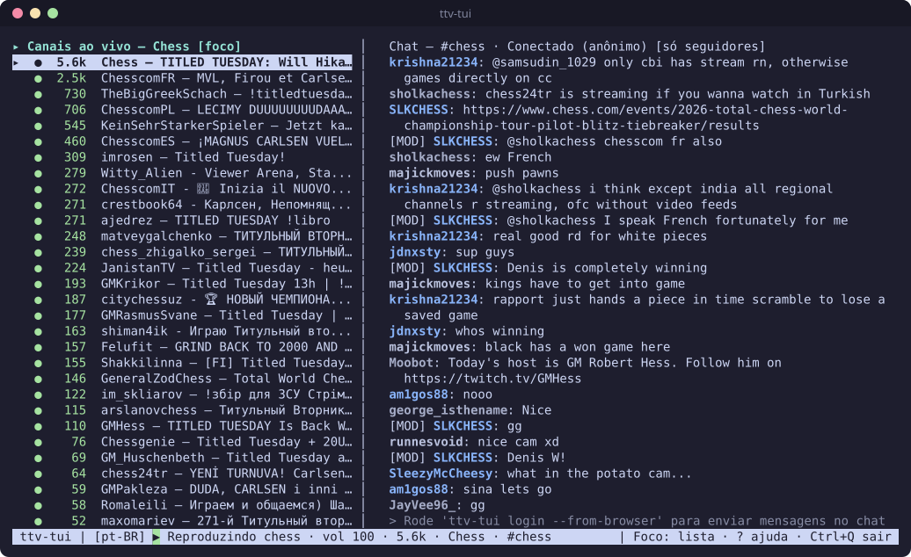
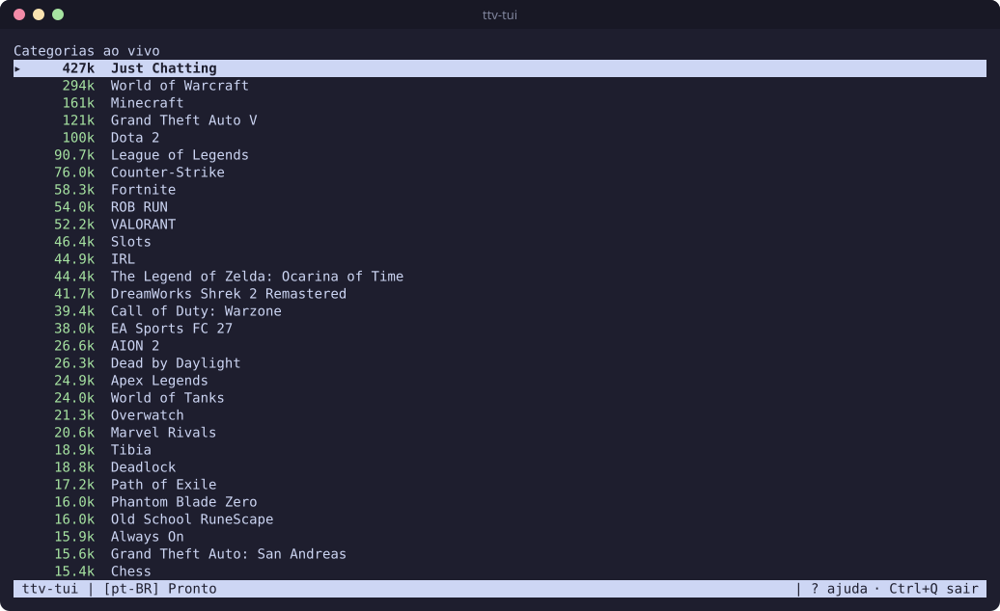
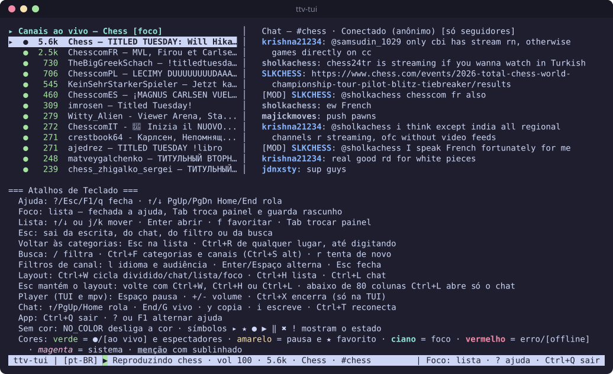

# ttv-tui

[](https://github.com/pedrosatin/ttv-tui/actions/workflows/ci.yml)

[English](../README.md)

Twitch no terminal. Navegue por categorias e canais ao vivo, assista e converse no chat sem abrir o navegador. O vídeo toca pelo `streamlink` e pelo `mpv`, com os trechos de anúncio filtrados. Para assistir e ler o chat, você não precisa de conta.



<details>
<summary>Mais capturas</summary>

Categorias ao vivo, a primeira tela:



Ajuda de atalhos, aberta com `?`:



</details>

## Instalação

Para tocar vídeo, `streamlink` e `mpv` são necessários. No Linux e no Windows, o `streamlink` é baixado sozinho na primeira reprodução quando não for encontrado. No Windows, a janela única toca o vídeo sem o `mpv`; só o modo terminal precisa dele. As [perguntas frequentes](#perguntas-frequentes) trazem o comando de instalação de cada sistema.

**Linux e macOS.** O script confere o SHA-256 e instala em `~/.local/bin`:

```bash
curl -fsSL https://raw.githubusercontent.com/pedrosatin/ttv-tui/main/packaging/install.sh | bash
```

**Windows x64.** A partir de um checkout, no PowerShell:

```powershell
.\packaging\install.ps1 -Version 0.9.0
winget install --id shinchiro.mpv -e
winget install --id streamlink.streamlink -e
```

<details>
<summary>Outras formas de instalar</summary>

**Arquivo da release.** Baixe o arquivo do seu sistema e o `checksums.txt` na [release v0.9.0](https://github.com/pedrosatin/ttv-tui/releases/tag/v0.9.0). Confira o SHA-256 com `sha256sum`, `shasum -a 256` ou `Get-FileHash -Algorithm SHA256` e coloque o `ttv-tui` no `PATH`.

**Go 1.27 ou mais novo:**

```bash
go install github.com/pedrosatin/ttv-tui/cmd/ttv-tui@v0.9.0
```

**Arch Linux.** O pacote do AUR ainda não foi publicado. Compile pelo PKGBUILD:

```bash
cd packaging && makepkg -si
```

**Pelo código-fonte:**

```bash
git clone https://github.com/pedrosatin/ttv-tui.git && cd ttv-tui
CGO_ENABLED=0 go build -o ~/.local/bin/ttv-tui ./cmd/ttv-tui
```

**Homebrew e Scoop.** A [fórmula](../packaging/homebrew/README.md) e o [manifesto do Scoop](../packaging/scoop/ttv-tui.json) estão prontos, mas ainda não foram publicados.

**Opções do script.** Informe uma versão, como `install.sh 0.9.0`, veja o plano com `--dry-run` ou mude o destino com `--prefix`. No Windows, `install.ps1 -DryRun` mostra o plano.

**Atalho de desktop.** O `install.sh` e o PKGBUILD instalam o atalho e o ícone. Depois de `go install` ou `go build`, copie os dois:

```bash
install -Dm644 packaging/ttv-tui.desktop ~/.local/share/applications/ttv-tui.desktop
install -Dm644 assets/ttv-tui.svg ~/.local/share/icons/hicolor/scalable/apps/ttv-tui.svg
```

</details>

## Uso

```bash
ttv-tui                     # navegar e assistir, sem conta
ttv-tui login --import twt  # opcional: usa o token do twitch-tui para enviar mensagens
ttv-tui doctor              # confere dependências, caminhos e se há token
```

Escolha uma categoria com `Enter` e depois um canal com `Enter`. A lista abre na Twitch; o `p` troca para a Kick e volta. Você também pode apertar `Ctrl+F` e colar a URL de uma transmissão (Twitch, Kick, YouTube) para tocar direto. A live começa e o chat abre à direita: Twitch e Kick têm chat, e o da Kick é só leitura. Aperte `?` para ver os atalhos.

## Plataformas

| Sistema | Build da release | Testes no CI | Testado à mão |
| --- | --- | --- | --- |
| Linux amd64 | Sim | Sim | Sim, no Arch Linux com Wayland |
| Linux arm64 | Sim | Não | Não |
| macOS arm64 (Apple Silicon) | Sim | Sim | Não |
| Windows x64 | Sim | Sim | Não |
| macOS Intel, Windows ARM | Sim, experimental | Não | Não |

> [!WARNING]
> Só o Linux amd64 foi testado à mão. No macOS e no Windows o código compila e os testes automáticos passam, mas ninguém conferiu vídeo, áudio, login, área de transferência ou encerramento numa máquina real. Os comandos de dependência desses sistemas e do Debian/Ubuntu também não foram rodados. Relatos são bem-vindos nas [issues](https://github.com/pedrosatin/ttv-tui/issues).

A tela dividida precisa de 80 colunas. Abaixo disso, o app mostra só o chat ou só a lista.

## Atalhos de teclado

<details open>
<summary>Lista e busca</summary>

| Tecla | Ação |
| --- | --- |
| `↑` `↓` ou `j` `k` | Move a seleção |
| `Enter` | Abre a categoria ou assiste ao canal |
| `f` | Favorita um canal ou fixa uma categoria; aperte de novo para remover |
| `/` | Filtra a lista atual; `Enter` abre o item destacado e `Ctrl+F` busca com o texto |
| `Ctrl+F` ou `Ctrl+S` | Busca canais e categorias na plataforma que a lista mostra, ou cola a URL de uma live |
| `p` | Troca a lista entre Twitch e Kick; o vídeo e o chat continuam |
| `l` | Filtra canais por idioma e público |
| `r` | Tenta de novo carregar a lista ou o vídeo |
| `Esc` | Limpa o filtro ou volta às categorias |
| `Ctrl+R` | Volta às categorias de qualquer lugar |
| `Tab` | Alterna o foco entre a lista e o chat |

</details>

<details open>
<summary>Chat</summary>

| Tecla | Ação |
| --- | --- |
| `i` | Escreve uma mensagem |
| `Enter` | Envia a mensagem |
| `Esc` | Sai da escrita e guarda o rascunho |
| `Ctrl+W` ou `Alt+Backspace` | Apaga a palavra anterior na mensagem, na busca e no filtro |
| `↑` `↓` `PgUp` `Home` | Rola o histórico |
| `End` ou `G` | Volta às mensagens ao vivo |
| `y` | Copia a mensagem selecionada |
| `Ctrl+T` | Reconecta ao chat |

</details>

<details open>
<summary>Vídeo, layout e app</summary>

| Tecla | Ação |
| --- | --- |
| `Space` | Pausa ou retoma |
| `+` `-` | Sobe ou desce o volume em 5% |
| `Ctrl+X` | Para o vídeo sem sair do app |
| `Ctrl+W` | Troca o layout: lista + chat, chat, lista, nenhum |
| `Ctrl+H` / `Ctrl+L` | Mostra ou esconde a lista / o chat |
| `?` ou `F1` | Mostra ou esconde a ajuda de atalhos |
| `Ctrl+Q` | Sai |

Com o foco na mensagem, na busca ou no filtro, o que se digita fica no campo: `Space`, `=` e `_` entram como texto, `Ctrl+W` apaga a palavra e `Ctrl+H` não faz nada. Fora do campo, voltam a ser atalhos.

`Space` e `+` `-` funcionam também na janela do `mpv`. As outras teclas dela não fazem nada.

</details>

<details>
<summary>Só na janela única</summary>

| Tecla | Ação |
| --- | --- |
| `Ctrl+→` / `Ctrl+←` | Alarga / estreita a lista |
| `Alt+←` / `Alt+→` | Alarga / estreita o chat |
| `Ctrl+O` | Põe o chat ao lado do vídeo ou sobre ele |
| `Alt+↑` / `Alt+↓` | Aumenta / diminui a opacidade do chat sobre o vídeo |
| `Ctrl+P` | Troca os lados da lista e do chat |

O app guarda essas escolhas no `config.toml`.

</details>

## Perguntas frequentes

<details>
<summary><b>Como funciona?</b></summary>

O app junta três ferramentas e desenha a interface em volta delas:

1. **Listas.** Categorias, canais e busca vêm da API GraphQL pública que a própria twitch.tv usa. O app não registra aplicativo na Twitch.
2. **Vídeo.** Quando você abre um canal, o app inicia o `streamlink`. Ele busca a live na melhor qualidade, descarta os trechos de anúncio e repassa o vídeo ao `mpv`. O app manda pausa, volume e parada ao `mpv` por um socket IPC JSON local.
3. **Chat.** O chat se conecta ao IRC da Twitch por TLS. Sem token, entra como anônimo e só lê.

O app toca um canal por vez. Abrir outro canal encerra o player anterior e leva o chat para a nova sala. Cada canal guarda o próprio rascunho de mensagem até você sair do app; a troca nunca o envia, e voltar ao canal traz o rascunho de volta. `Ctrl+X` para só o vídeo, e o chat continua aberto. `Ctrl+Q` encerra o `streamlink` e o `mpv`, apaga os arquivos temporários de IPC e desconecta o chat.

Os [ADRs](adr/) explicam cada escolha.

</details>

<details>
<summary><b>Como instalo as dependências?</b></summary>

`streamlink` e `mpv` são obrigatórios para o vídeo. `sqlite3` e `secret-tool` só importam para o `login --from-browser`.

| Sistema | Comando |
| --- | --- |
| Arch Linux | `sudo pacman -S streamlink mpv sqlite libsecret` |
| Debian / Ubuntu | `sudo apt install streamlink mpv sqlite3 libsecret-tools` |
| macOS | `brew install mpv streamlink` |
| Windows (winget) | `winget install --id shinchiro.mpv -e` e `winget install --id streamlink.streamlink -e` |
| Windows (Scoop) | `scoop bucket add extras` e `scoop install extras/mpv extras/streamlink` |

Só o comando do Arch foi testado. Se a sua distribuição traz um `streamlink` antigo, instale um atual com `pipx install streamlink`.

A janela única no Linux também precisa do SDL3 e do libmpv. No Arch, é `sudo pacman -S sdl3 mpv`.

Depois, rode `ttv-tui doctor`. Ele lista o que falta.

</details>

<details>
<summary><b>Como funcionam os favoritos e os canais recentes?</b></summary>

Aperte `f` num canal para pô-lo nos favoritos ou numa categoria para fixá-la. Aperte de novo para remover. As categorias fixadas aparecem no topo da tela inicial da própria plataforma. Enter abre os canais dela. A audiência vem do catálogo carregado; sem contagem atual, a categoria mostra `[não verificado]`. Na busca, categorias fixadas aparecem com ★. Todo canal que você abre entra nos recentes, que guardam os últimos 50. A tela inicial mostra os favoritos, os 6 recentes mais novos e uma linha `mais…` que abre o resto. Numa categoria ou numa busca, os resultados vêm primeiro, e um favorito fica no lugar dele, marcado com ★.

Numa sessão nova, esses canais aparecem com `[não verificado]` até você abri-los ou eles surgirem numa lista ao vivo. Eles ficam no `state.json`, não na sua conta da Twitch.

</details>

<details>
<summary><b>Preciso de conta na Twitch?</b></summary>

Não. Navegar, assistir e ler o chat funcionam sem login. O token só serve para enviar mensagens.

</details>

<details>
<summary><b>Dá para assistir Kick?</b></summary>

Dá. Aperte `p` e a lista mostra as categorias ao vivo da Kick, das mais assistidas para as menos. O `Enter` abre uma categoria e lista os canais dela com espectadores e título, o `/` filtra o que está carregado e o `Ctrl+F` busca canais e categorias da Kick pelo nome. O resultado da busca só diz se o canal está ao vivo; título e espectadores aparecem quando você o abre. O canal que esconde a contagem de espectadores na Kick mostra `[vivo]` no lugar do número. O `p` de novo volta para a Twitch.

A URL também serve: aperte `Ctrl+F` e cole `https://kick.com/<canal>`. Todo canal aberto entra nos recentes, onde o `f` o põe nos favoritos, e a lista mostra se ele está ao vivo, com título e espectadores.

O chat abre ao lado do vídeo e é só leitura. Enviar exige conta na Kick e um app registrado, que este projeto não usa. Emotes aparecem pelo nome, e a mensagem que um moderador apaga continua na tela.

A Kick não tem API pública para nada disso sem conta. O app lê o JSON que o próprio site usa e a conexão de chat que o player do site abre, então os dois podem parar de funcionar quando a Kick mudar algo:

- `Catálogo da Kick indisponível agora`: a barreira na frente do site (Cloudflare) recusou o app. Os favoritos e os recentes continuam na tela e ainda abrem. Aperte `r` para tentar mais tarde ou `p` para voltar à Twitch.
- `Kick recusou o pedido (HTTP 403)`: a barreira na frente do site bloqueou o app. Espere um pouco e aperte `Ctrl+T` para tentar o chat de novo.
- `Kick recusou a chave do chat`: a Kick trocou a chave do serviço de chat (Pusher). Abra um canal da Kick no navegador, ache na aba de rede o WebSocket para `ws-us2.pusher.com/app/<chave>` e ponha essa chave no `config.toml`:

  ```toml
  kick_pusher_key = "<chave>"
  ```

- O chat da Kick conecta direto no Pusher e ignora o `HTTPS_PROXY`. Atrás de um proxy obrigatório, a lista ainda mostra o estado do canal, mas o chat fica reconectando.

</details>

<details>
<summary><b>Como faço login para enviar mensagens?</b></summary>

Escolha um:

- `ttv-tui login --import twt` copia o token do [twitch-tui](https://github.com/Xithrius/twitch-tui). É um token restrito ao chat, por isso é o preferido.
- `ttv-tui login --from-browser` copia o cookie `auth-token` do Brave, Chrome, Chromium, Edge, Vivaldi, Opera ou Firefox. Passe `--browser` e `--profile` para pular a pergunta. Por enquanto funciona só no Linux e precisa do `sqlite3`. Navegadores da família Chromium também precisam do `secret-tool`, do pacote `libsecret`.

</details>

<details>
<summary><b>O <code>--from-browser</code> é seguro?</b></summary>

Saiba o que ele alcança antes de usar:

- O cookie `auth-token` é uma sessão completa da sua conta na Twitch, não um token só de chat.
- Para decifrá-lo nos navegadores da família Chromium, o app lê a chave do navegador no chaveiro do sistema. Essa chave decifra todos os cookies daquele navegador. O app lê só a linha da Twitch e descarta a chave quando o `login` termina.
- O token fica em texto puro no `config.toml`, com permissão `0600` no Linux e no macOS. O app nunca o imprime.

Os detalhes estão no [SECURITY.md](../SECURITY.md).

</details>

<details>
<summary><b>Como saio da conta ou revogo o token?</b></summary>

Apagar o arquivo local não encerra a sessão na Twitch. Faça as duas coisas:

1. Na twitch.tv, abra **Configurações → Segurança e privacidade → Sair em todos os lugares**. Para um token importado do `twt`, você também pode revogá-lo em **Configurações → Conexões**.
2. Apague o `config.toml`. O `ttv-tui doctor` mostra onde ele está. No Linux:

   ```bash
   rm -f "${XDG_CONFIG_HOME:-$HOME/.config}/ttv-tui/config.toml"
   ```

</details>

<details>
<summary><b>Bloqueia anúncio?</b></summary>

Na Twitch, o `streamlink` descarta os trechos de anúncio da transmissão. Durante o intervalo, a barra de status mostra `Intervalo comercial: o vídeo volta sozinho` com uma contagem regressiva.

Uma live da Kick toca como a Kick a envia. O app não filtra nem detecta intervalo comercial nela.

</details>

<details>
<summary><b>Por que o vídeo abre em outra janela?</b></summary>

O app não decodifica vídeo. O `mpv` toca numa janela própria, e o app o controla por IPC. A janela do `mpv` não tem controles. Use as teclas do app e feche o vídeo com `Ctrl+X` ou fechando a janela.

Quando o `ttv-tui-window` está ao lado do `ttv-tui` e consegue abrir uma janela, o app abre uma janela única, com a lista, o vídeo e o chat lado a lado. Ela precisa do SDL3 e do libmpv. No Linux amd64, o script de instalação já instala o `ttv-tui-window`; ele foi testado à mão no Wayland, não no X11. No Windows x64, o `install.ps1` o instala numa pasta `ttv-tui-window`, com as DLLs; uma prova de conceito funcionou no Windows 11. No macOS ele é compilado a partir do código, e ninguém o testou lá. Para ficar no terminal, rode `ttv-tui --terminal`. Por enquanto, emoji colorido aparece como quadrado vazio nessa janela. Veja os ADRs [0011](adr/0011-janela-unica.md) e [0012](adr/0012-janela-unica-multiplataforma.md).

</details>

<details>
<summary><b>Para onde foi o chat?</b></summary>

O terminal tem menos de 80 colunas, e a tela dividida esconde o chat. Aperte `Ctrl+L` para ver o chat na largura toda ou alargue o terminal.

</details>

<details>
<summary><b>O que significam <code>[enviando]</code>, <code>[recusada]</code> e as outras marcas do chat?</b></summary>

| Marca | Significado |
| --- | --- |
| `[enviando]` / `[confirmada]` | Esperando o servidor / o servidor confirmou a mensagem |
| `[recusada: <motivo>]` | Não foi enviada. O motivo pode ser modo lento, só seguidores, só inscritos, só emotes, mensagem repetida, banimento ou falta de resposta do servidor |
| `[descartada: …]` | A mensagem bateu no limite da Twitch, de 20 mensagens a cada 30 segundos, ou você trocou de canal antes do envio |
| `[novo]` | Mensagem de uma conta nova |
| `[apagada]` | Um moderador apagou a mensagem. Você ainda pode ler e copiar o texto |

Mensagens com menos de 1 segundo de intervalo esperam numa fila. Comandos com barra são bloqueados, exceto `/me`, e o rascunho fica.

</details>

<details>
<summary><b>Dá para banir, silenciar ou apagar mensagens?</b></summary>

Não. A Twitch tirou os comandos de moderação do IRC, e um `/ban` sairia como mensagem pública. Moderação exige a API Helix e um app registrado na Twitch, que este projeto não usa.

</details>

<details>
<summary><b>Mostra emotes, VODs ou os canais que eu sigo?</b></summary>

Ainda não:

- Emotes aparecem como texto. As imagens da Twitch, do BTTV e do 7TV não são desenhadas.
- Só lives tocam. VODs e clipes, não.
- Favoritos e canais recentes não sincronizam com os canais que você segue na Twitch.

</details>

<details>
<summary><b>Onde o app guarda os arquivos?</b></summary>

| Sistema | Config e token | Favoritos e recentes |
| --- | --- | --- |
| Linux | `~/.config/ttv-tui/config.toml` | `~/.local/state/ttv-tui/state.json` |
| macOS | `~/Library/Application Support/ttv-tui/config.toml` | `~/Library/Application Support/ttv-tui/state/state.json` |
| Windows | `%APPDATA%\ttv-tui\config.toml` | `%LOCALAPPDATA%\ttv-tui\state.json` |

`XDG_CONFIG_HOME` e `XDG_STATE_HOME` substituem esses caminhos em qualquer sistema. Se o `state.json` corromper, o app o salva como `state.json.bak` e começa com as listas vazias.

</details>

<details>
<summary><b>O vídeo não toca ou não tem som</b></summary>

1. Rode `ttv-tui doctor`. Ele aponta `streamlink` ou `mpv` ausentes, os caminhos em uso e se há token, sem mostrá-lo.
2. `Erro: Canal offline` quer dizer que a live acabou. Escolha outro canal ou aperte `r` para tentar de novo.
3. Confira se a barra de status não mostra `vol 0`. Aperte `+` para subir o volume.
4. No Linux, confira se `WAYLAND_DISPLAY` ou `DISPLAY` está definido e se há um servidor de áudio rodando.
5. Depois de uma falha, aperte `?` para ler o último erro do `streamlink` ou do `mpv`.

</details>

<details>
<summary><b>O app pede para encerrar "um player de uma sessão anterior"</b></summary>

Uma execução anterior foi morta antes de fechar o `streamlink` e o `mpv`. Responda `S` para encerrar o player que sobrou.

</details>

<details>
<summary><b>Como mudo o idioma ou desligo as cores?</b></summary>

Passe `--lang en` ou `--lang pt-BR`, ou defina `language` no `config.toml`. Sem nenhum dos dois, o app segue o seu `LANG` e, na falta dele, usa inglês.

Para desligar as cores, rode com `NO_COLOR=1`. Os símbolos `▸ ★ ● ▶ ‖ ✖` continuam mostrando o estado.

</details>

<details>
<summary><b>Para onde o <code>y</code> copia?</b></summary>

Dentro do tmux, o app tenta primeiro o buffer do tmux. Depois tenta `wl-copy`, `xclip` e OSC 52, nessa ordem. A barra de status diz qual funcionou. Dentro do tmux, o OSC 52 precisa de `set-clipboard on`. A cópia leva o canal e o horário, por exemplo `canal #login · 2026-11-10 14:30 · nick: texto`.

</details>

<details>
<summary><b>Por que <code>Ctrl+C</code> não sai? <code>Ctrl+S</code> não trava o terminal?</b></summary>

Saia com `Ctrl+Q`, que funciona até durante a digitação. `Ctrl+C` só mostra o aviso `Para sair use Ctrl+Q`.

O app põe o terminal em modo raw, e o terminal repassa `Ctrl+S` e `Ctrl+Q` ao app em vez de pausar a saída.

</details>

## Desenvolvimento

<details>
<summary>Build, testes e lint</summary>

São as mesmas verificações do CI:

```bash
TMPDIR=/tmp go build ./...
TMPDIR=/tmp go vet ./...
TMPDIR=/tmp go test -count=1 ./...
TMPDIR=/tmp go test -race -count=1 ./internal/player ./internal/chat ./internal/ui ./internal/store
TMPDIR=/tmp go run github.com/golangci/golangci-lint/v2/cmd/golangci-lint@v2.15.0 run
```

O `TMPDIR=/tmp` mantém os caminhos dos sockets de teste abaixo do limite de 108 bytes do Unix.

Os cenários de UX (teclas na entrada, a tela inteira comparada com um golden) estão descritos em [`cenarios-de-ux.md`](cenarios-de-ux.md).

As decisões de desenho estão em [`docs/adr/`](adr/).

</details>

## Licença

MIT. Veja [LICENSE](../LICENSE).
