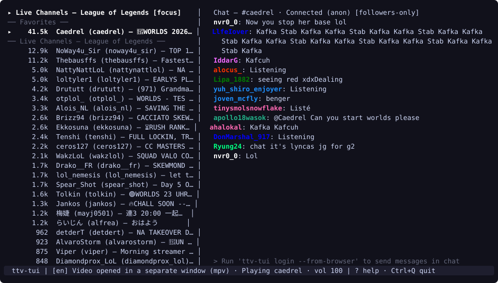
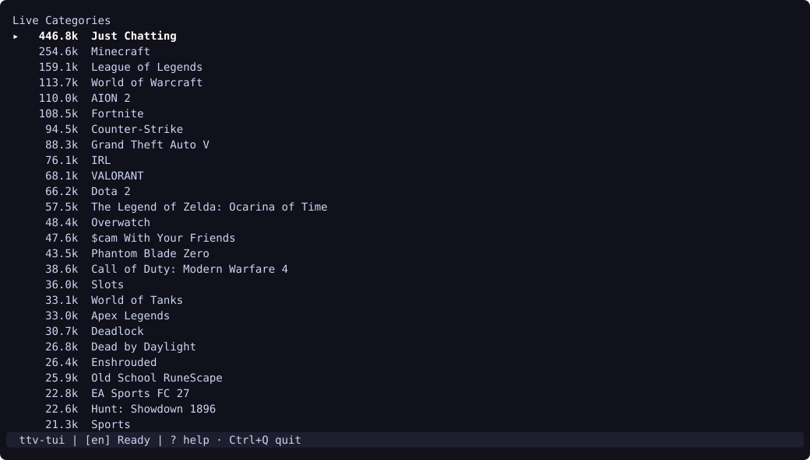
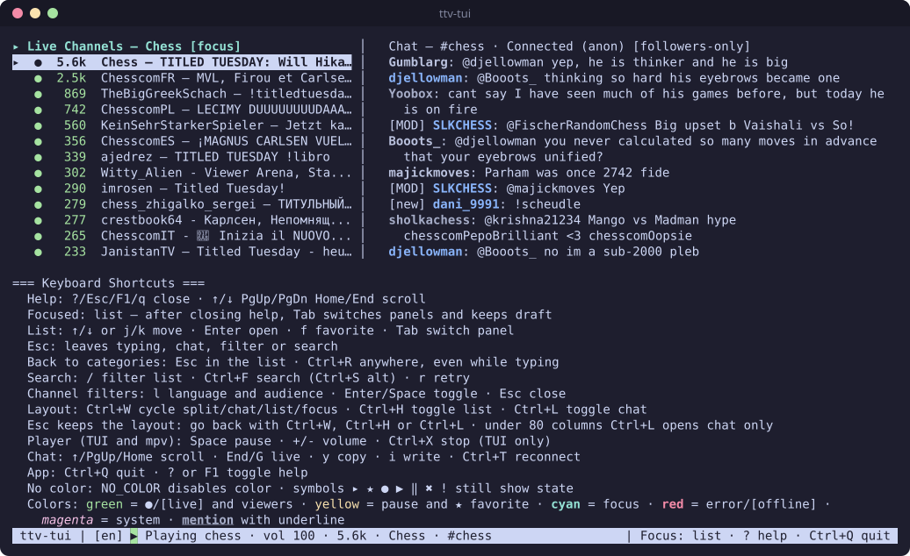
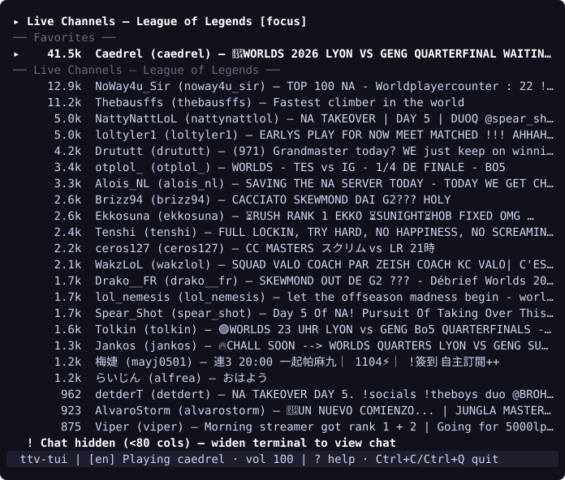

# ttv-tui

[](https://github.com/pedrosatin/ttv-tui/actions/workflows/ci.yml)

[English](../README.md)

Twitch no terminal para Linux. Navegue por categorias e canais ao vivo, assista às transmissões via `streamlink` e `mpv` com filtro de anúncios e controles de reprodução pela própria TUI, e converse no chat IRC sem abrir o navegador.



## Instalação

### Binário da release (v0.1.4, Linux amd64 / arm64)

Baixe o tarball da sua arquitetura (`linux_amd64` ou `linux_arm64`) e o arquivo `checksums.txt` da [release v0.1.4](https://github.com/pedrosatin/ttv-tui/releases/tag/v0.1.4), confira o hash SHA-256 e instale o binário em `~/.local/bin`:

```bash
ARCH=amd64 # ou arm64
curl -LO "https://github.com/pedrosatin/ttv-tui/releases/download/v0.1.4/ttv-tui_0.1.4_linux_${ARCH}.tar.gz"
curl -LO "https://github.com/pedrosatin/ttv-tui/releases/download/v0.1.4/checksums.txt"
sha256sum --ignore-missing -c checksums.txt

mkdir -p ~/.local/bin
tar -xzf "ttv-tui_0.1.4_linux_${ARCH}.tar.gz" -C ~/.local/bin ttv-tui
```

Confirme que `~/.local/bin` está no seu `PATH`.

### Com `go install`

Requer Go 1.27 ou superior:

```bash
go install github.com/pedrosatin/ttv-tui/cmd/ttv-tui@v0.1.4
```

### Arch Linux (AUR)

O pacote `ttv-tui-bin` no AUR está planejado, mas ainda não foi publicado. Enquanto ele não estiver disponível no AUR, gere e instale o pacote diretamente a partir de [`packaging/PKGBUILD`](../packaging/PKGBUILD):

```bash
cd packaging
makepkg -si
```

### Compilar a partir do código-fonte

Requer Go 1.27:

```bash
git clone https://github.com/pedrosatin/ttv-tui.git
cd ttv-tui
CGO_ENABLED=0 go build -ldflags "-s -w -X main.version=0.1.4" -o ~/.local/bin/ttv-tui ./cmd/ttv-tui
```

## Requisitos

### Obrigatórios (reprodução de vídeo)

- Linux.
- `streamlink` no `PATH` para negociar a reprodução do stream e filtrar blocos de anúncios. Sem ele, não há reprodução de vídeo.
- `mpv` no `PATH` para decodificar e exibir o vídeo em janela própria com controle por socket JSON IPC local. Sem ele, não há reprodução de vídeo.

### Opcionais (login e chat)

- `sqlite3` no `PATH`. O `ttv-tui` executa o binário `sqlite3` apenas durante `ttv-tui login --from-browser` para copiar e consultar o banco de cookies do navegador pelo comando `.backup` do SQLite sem disputar lock com o navegador aberto. Não é necessário para navegar e assistir de forma anônima nem para importar credenciais via `ttv-tui login --import twt`.
- Um navegador compatível logado em `twitch.tv` (Brave, Chrome, Chromium, Edge, Vivaldi, Opera ou Firefox) caso queira enviar mensagens no chat via `--from-browser`. Nos navegadores da família Chromium, `secret-tool` (`libsecret`) também precisa estar no `PATH` para ler o segredo OSCrypt Safe Storage no keyring da sessão. Navegar pelas categorias, assistir aos vídeos e ler o chat funcionam de forma anônima sem login.

## Uso rápido

1. Configure um token da Twitch se quiser enviar mensagens no chat. Se você já tem o `twitch-tui` (`twt`) configurado em `~/.config/twt/config.toml` ou prefere um token restrito ao chat sem ler cookies do navegador nem o keyring da sessão, dê preferência à importação do `twt`:

```bash
ttv-tui login --import twt
```

Caso contrário, extraia o cookie de sessão `auth-token` de um navegador instalado. Consulte [Login e segurança](#login-e-segurança) sobre o alcance do segredo do keyring e do cookie de sessão:

```bash
ttv-tui login --from-browser
```

Se houver mais de um perfil de navegador instalado, passe `--browser` e `--profile` diretamente ou escolha na lista interativa:

```bash
ttv-tui login --from-browser --browser brave --profile Default
```

2. Inicie a interface:

```bash
ttv-tui
```

O idioma da interface segue a opção `--lang` (`en` ou `pt-BR`), o campo `language` em `config.toml` ou as variáveis de ambiente `LC_ALL`, `LC_MESSAGES` e `LANG`, com padrão em inglês.

## Passo a passo

Ao iniciar, o `ttv-tui` carrega as categorias ao vivo mais assistidas na Twitch:



Selecione uma categoria com `Enter` para listar os canais ao vivo e pressione `Enter` sobre um canal para abrir a reprodução de vídeo no `mpv` e entrar no chat IRC do canal no painel direito:


Pressione `?` ou `F1` a qualquer momento para exibir o quadro de atalhos de teclado:



Para um roteiro passo a passo em inglês cobrindo instalação, autenticação, troca de canais, favoritos, chat, terminais estreitos e encerramento, consulte o [walkthrough completo](walkthrough.md).

## Atalhos de teclado

Pressione `?` ou `F1` para abrir ou fechar o quadro de atalhos no aplicativo. As tabelas abaixo trazem todos os atalhos, incluindo dois detalhes omitidos no quadro resumido da tela: as teclas `=` e `_` como alternativas para o volume e o funcionamento de `F1` durante a digitação em campos de texto.

### Navegação na lista e busca

| Tecla | Ação |
| --- | --- |
| `↑` / `↓` ou `j` / `k` | Mover a seleção para cima ou para baixo na lista e carregar mais itens no fim |
| `Enter` | Abrir a categoria destacada ou iniciar a reprodução do canal destacado |
| `f` | Adicionar ou remover o canal destacado dos Favoritos |
| `/` | Filtrar a lista atual localmente (`Enter` mantém o filtro, `Esc` limpa) |
| `Ctrl+F` | Buscar canais em toda a Twitch, reaproveitando o texto ativo de `/` se houver |
| `Ctrl+S` | Igual a `Ctrl+F` (atalho alternativo). Muitos terminais ligam o controle de fluxo por software (`ixon`), então Ctrl+S vira XOFF e não chega ao app — use `stty -ixon` se quiser esse atalho |
| `r` | Tentar carregar a lista novamente ou repetir a reprodução após falha no player |
| `Esc` | Limpar o filtro ativo ou voltar de canais e resultados de busca para as categorias |
| `Ctrl+R` | Voltar para Categorias ao vivo de qualquer tela, mesmo durante a digitação |
| `Tab` | Alternar o foco do teclado entre o painel da lista e o painel do chat |

### Chat

| Tecla | Ação |
| --- | --- |
| `↑` / `k`, `↓` / `j`, `PgUp`, `Home` | Rolar o histórico do chat; a seleção acompanha a mensagem na base visível |
| `End` / `G` | Voltar a acompanhar o chat ao vivo |
| `y` | Copiar a mensagem selecionada do chat (ou a mais recente ao vivo) via `wl-copy`, `xclip` ou OSC 52 |
| `i` | Focar no chat e iniciar a digitação de uma mensagem no canal atual |
| `Enter` | Enviar a mensagem escrita para o chat |
| `Esc` | Sair do campo de mensagem preservando o rascunho ou devolver o foco para a lista |
| `Ctrl+T` | Reconectar ao chat IRC do canal atual |

### Player de vídeo (janela do `mpv`)

| Tecla | Ação |
| --- | --- |
| `Space` | Pausar ou retomar a reprodução do vídeo |
| `+` / `=` | Aumentar o volume do `mpv` em 5% |
| `-` / `_` | Diminuir o volume do `mpv` em 5% |
| `Ctrl+X` | Encerrar a reprodução de vídeo sem sair do aplicativo |

### Aplicativo

| Tecla | Ação |
| --- | --- |
| `?` ou `F1` | Mostrar ou ocultar o quadro de atalhos (`F1` funciona mesmo durante a digitação) |
| `Ctrl+Q` | Encerrar o vídeo ativo, desconectar do chat e sair |

Com o controle de fluxo por software (`ixon`) ligado, o terminal pode tratar Ctrl+S como XOFF e Ctrl+Q como XON antes do app receber as teclas. Prefira `Ctrl+F` para buscar. A TUI roda em raw mode, então `Ctrl+Q` normalmente ainda sai; se o terminal engolir a tecla, desligue o `ixon` com `stty -ixon`.

## Layout

O `ttv-tui` organiza a tela em dois painéis quando um canal está aberto:

- **Painel esquerdo.** Lista de navegação com Favoritos, canais Recentes e Categorias ao vivo, Canais ao vivo ou Resultados da busca.
- **Painel direito.** Chat IRC ao vivo do canal ativo, com indicadores de modo da sala (`slow`, `followers-only`, `subs-only`) no cabeçalho e campo de escrita na base.
- **Barra inferior.** Barra de status com o idioma ativo (`[en]` ou `[pt-BR]`), estado da reprodução, volume, canal em foco e dicas de teclas.

Pressione `Tab` para alternar o foco entre a lista e o chat. O cabeçalho do painel ativo exibe `[foco]` (`[focus]` em inglês).

Adaptação à largura do terminal:

- **100 colunas ou mais.** Divisão lado a lado com cerca de 40% da largura para a lista e 60% para o chat.
- **80 a 99 colunas.** Divisão lado a lado com coluna de chat compacta de no mínimo 34 colunas para manter a leitura da lista.
- **Menos de 80 colunas.** O painel de chat é ocultado automaticamente e um aviso (`! Chat oculto (<80 col.)` / `! Chat hidden (<80 cols)`) aparece acima da barra de status. Alargue o terminal para 80 colunas ou mais para restaurar o chat.



## Chat

- **Leitura anônima.** A conexão e a leitura do chat de qualquer canal usam login IRC anônimo da Twitch (`justinfan...`) sobre TLS (`irc.chat.twitch.tv:6697`) com tags IRCv3 habilitadas. Nenhuma conta ou token é exigido para ler o chat.
- **Envio autenticado.** Pressionar `i` para redigir uma mensagem exige um token válido salvo em `config.toml`.
- **Copiar mensagem (`y`).** Com o foco no painel do chat, `y` copia a mensagem selecionada (a da base visível, ou a mais recente enquanto o chat acompanha o ao vivo) para a área de transferência do sistema. O conteúdo é só `autor: texto` (linhas de sistema copiam só o texto), sem coluna da lista, sem `│` e sem preenchimento. A seleção por mouse não é usada. Caminhos de cópia, nesta ordem: (1) `wl-copy` quando `WAYLAND_DISPLAY` existe e `wl-copy` está no `PATH` (o texto permanece depois que o app sai); (2) `xclip -selection clipboard` quando `DISPLAY` existe e `xclip` está no `PATH`; (3) OSC 52 no stderr para SSH/tmux e hosts sem esses helpers. Se um caminho falhar, o próximo é tentado. A barra de status nomeia o caminho que funcionou (`Copiado via wl-copy: …` / `xclip` / `OSC 52`), ou mostra erro claro se todos falharem. Para o caminho OSC 52 dentro do tmux, ative `set-clipboard on` (por exemplo em `~/.tmux.conf`) para a sequência chegar à área de transferência do sistema.
- **Limites de envio.** As mensagens enviadas passam por um limitador local alinhado aos limites da Twitch de 20 mensagens a cada 30 segundos no total e 1 mensagem por segundo por canal. Mensagens com intervalo menor que 1 segundo entram em fila automaticamente; se a janela de 20 mensagens estiver cheia, o excedente é marcado como `[discarded: rate limit exceeded (20/30s or 1/s)]`.
- **Rastreamento de entrega e restrições da sala.** Cada mensagem enviada recebe um identificador próprio do cliente e aparece como `[sending]` até a confirmação do servidor (`[sent]`). Se a sala recusar a mensagem por modo lento, modo exclusivo para seguidores, modo exclusivo para inscritos, modo apenas emotes, regra contra repetição (R9K) ou banimento/timeout, o `ttv-tui` marca a linha como `[rejected: <motivo>]`.

## Login e segurança

O `ttv-tui` não registra aplicação OAuth na Twitch e não embute segredo de cliente OAuth de terceiros. A autenticação pode ser feita importando um token do `twitch-tui` (`--import twt`) ou extraindo o cookie de sessão do navegador (`--from-browser`):

1. **O que `--from-browser` lê.** O `ttv-tui` localiza os bancos de cookies dos navegadores instalados: Brave, Chrome, Chromium, Edge, Vivaldi, Opera e Firefox, incluindo caminhos de Flatpak e Snap do Firefox. Ele copia o banco SQLite para um diretório temporário via `sqlite3 <db> ".backup '<tmp>'"`, com fallback para cópia de arquivo acompanhada dos sidecars `-wal` e `-shm`, consulta apenas o cookie `auth-token` de `.twitch.tv` / `twitch.tv` e apaga a cópia temporária em seguida. O arquivo original do navegador nunca é alterado.
2. **Alcance do segredo do keyring e descriptografia dos cookies.**
   - **Firefox.** Grava todos os cookies em texto puro dentro de `cookies.sqlite`.
   - **Família Chromium.** Criptografa os cookies com AES-128-CBC (`v10` / `v11`). O `ttv-tui` executa `secret-tool` (`libsecret`) para ler a senha OSCrypt Safe Storage do navegador no keyring da sessão gráfica (`application=<navegador>` no schema `chrome_libsecret_os_crypt_password_v2`, ou o par legado `service="<Browser> Safe Storage"`), deriva a chave AES de 16 bytes com PBKDF2-HMAC-SHA1 (`saltysalt`, 1 iteração) e descarta o prefixo SHA-256 de 32 bytes do `host_key` usado nas versões recentes do banco do Chromium (`meta.version >= 24`). Como o Chromium usa um único segredo Safe Storage por instalação de navegador, essa chave do keyring é capaz de decifrar **todos** os cookies salvos por aquele navegador em qualquer site, e não apenas o `auth-token` de `twitch.tv`. Embora o `ttv-tui` consulte somente a linha `auth-token` de `twitch.tv` e mantenha a chave derivada em memória apenas durante a execução de `login`, desbloquear o keyring concede ao processo acesso à chave mestra de cookies daquele navegador.
3. **Escopo de sessão completa e armazenamento em texto puro.**
   - **Sessão completa da conta.** O cookie `auth-token` de `twitch.tv` é um token de sessão web completa da sua conta na Twitch, e não um token OAuth restrito aos escopos de chat (`chat:read` / `chat:edit`). Qualquer processo ou pessoa que obtenha esse valor passa a ter acesso integral à sessão da conta até que ela seja invalidada.
   - **Texto puro em disco (`0600`).** Após validar o token em `https://id.twitch.tv/oauth2/validate` para obter nome de usuário, escopos e tempo de expiração, o `ttv-tui` grava o token em texto puro em `~/.config/ttv-tui/config.toml` (ou `$XDG_CONFIG_HOME/ttv-tui/config.toml`) com permissão `0600`, legível e gravável apenas pelo seu usuário do sistema operacional. Qualquer processo rodando sob o seu usuário consegue ler esse arquivo. O valor do token nunca é impresso em stdout, stderr ou logs de erro.
4. **Quando preferir `--import twt`.** Se você já tem o `twitch-tui` configurado em `~/.config/twt/config.toml` ou prefere usar um token OAuth restrito ao chat sem expor o banco de cookies do navegador nem o segredo Safe Storage do keyring, execute `ttv-tui login --import twt` no lugar de `--from-browser`.
5. **Como revogar.** Apagar `config.toml` remove apenas a cópia local; o token continua válido nos servidores da Twitch até ser revogado na conta. Para invalidar a sessão nos servidores da Twitch, acesse `twitch.tv` e use **Configurações -> Segurança e privacidade -> Sair em todos os lugares** (**Settings -> Security and Privacy -> Sign Out Everywhere**), encerre a sessão do navegador de onde o cookie foi extraído ou revogue a conexão em **Configurações -> Conexões** caso tenha importado via `--import twt`. Em seguida, apague o arquivo de configuração local:

```bash
rm -f "${XDG_CONFIG_HOME:-$HOME/.config}/ttv-tui/config.toml"
```

Consulte [SECURITY.md](../SECURITY.md) para instruções de relato privado de vulnerabilidades e revogação de credenciais.

## Solução de problemas

- **`Canal offline: escolha outro canal` (`Channel offline: pick another channel`).** O `streamlink` informou que não há transmissão ativa para aquele canal. Escolha outro canal ao vivo ou pressione `r` para atualizar a lista.
- **`streamlink não encontrado` / `mpv não encontrado` (`streamlink not found` / `mpv not found`).** Instale `streamlink` e `mpv` pelo gerenciador de pacotes da sua distribuição e confirme que ambos estão no `PATH`.
- **`sqlite3 não encontrado no PATH` durante o login.** Instale o pacote de linha de comando `sqlite` / `sqlite3`, como `sudo pacman -S sqlite` ou `sudo apt install sqlite3`.
- **`keyring bloqueado ou ausente` durante o login.** Desbloqueie o keyring da sua sessão gráfica ou instale `libsecret` (`secret-tool`), faça login pelo Firefox usando `--browser firefox` ou importe um token com `ttv-tui login --import twt`.
- **`Token expirado ou inválido` (`Token expired or invalid`).** Os tokens de sessão do navegador expiram quando a sessão web termina. Faça login novamente em `twitch.tv` pelo navegador e execute `ttv-tui login --from-browser` ou `ttv-tui login --import twt`.
- **Pergunta sobre player órfão ao iniciar (`Um player de uma sessão anterior ainda está tocando...`).** Se um processo anterior do `ttv-tui` foi interrompido de forma abrupta com `SIGKILL`, o grupo de processos `streamlink` e `mpv` pode ter continuado em execução. Na abertura seguinte, o `ttv-tui` confere o PID e o socket registrados em `~/.local/state/ttv-tui/players/` e pergunta `[S/n]` antes de encerrar o player remanescente.
- **Chat oculto.** O `ttv-tui` oculta o painel direito de chat quando a largura do terminal fica abaixo de 80 colunas. Redimensione a janela do terminal ou o painel do tmux para pelo menos 80 colunas.
- **Sem janela de vídeo ou sem áudio no `mpv`.** O `ttv-tui` inicia o `mpv` com `--no-config --force-window=immediate --hwdec=auto-safe`. Verifique se a sessão gráfica Wayland ou X11 (`DISPLAY` ou `WAYLAND_DISPLAY`) e o servidor de áudio (PipeWire / PulseAudio) estão ativos, e confira se o volume na barra de status não está em `vol 0` (pressione `+` para aumentar). Pressione `?` após uma falha de reprodução para ler a linha `Último erro do player` (`Last player error`) retornada pelo `streamlink` ou pelo `mpv`.

## Desenvolvimento

Execute a compilação, `go vet`, a suíte de testes, o detector de condição de corrida e o `golangci-lint` `v2.15.0` conforme definido em [`.github/workflows/ci.yml`](../.github/workflows/ci.yml):

```bash
TMPDIR=/tmp go build ./...
TMPDIR=/tmp go vet ./...
TMPDIR=/tmp go test -count=1 ./...
TMPDIR=/tmp go test -race -count=1 ./internal/player ./internal/chat ./internal/ui ./internal/store
TMPDIR=/tmp go run github.com/golangci/golangci-lint/v2/cmd/golangci-lint@v2.15.0 run
```

- **Por que `TMPDIR=/tmp` é usado.** Os testes de `internal/player` criam diretórios temporários via `t.TempDir()` e abrem sockets Unix locais (`i`) do `mpv` dentro deles. O kernel Linux limita `sockaddr_un.sun_path` a 108 bytes, e o pacote `internal/player` impõe o teto de 100 bytes. Quando o ambiente define um `TMPDIR` longo, o caminho do socket dentro de `t.TempDir()` pode ultrapassar esse limite de bytes e falhar ao abrir o socket. Definir `TMPDIR=/tmp` mantém curtos os caminhos de socket durante os testes.
- **Versão fixada do `golangci-lint` (`v2.15.0`).** O CI executa `golangci-lint` na versão `v2.15.0`. Se o binário `golangci-lint` `v2.15.0` já estiver instalado no seu `PATH`, basta rodar `TMPDIR=/tmp golangci-lint run`.

### Arquivos e diretórios XDG

O `ttv-tui` armazena configuração, estado persistente e sockets de execução nos diretórios XDG padrão:

| Finalidade | Caminho | Fallback |
| --- | --- | --- |
| Configuração (`config.toml`, modo `0600`) | `$XDG_CONFIG_HOME/ttv-tui/config.toml` | `~/.config/ttv-tui/config.toml` |
| Estado persistente (`state.json`: favoritos e até 50 canais recentes) | `$XDG_STATE_HOME/ttv-tui/state.json` | `~/.local/state/ttv-tui/state.json` |
| Registro de players ativos (detecção de processos órfãos) | `$XDG_STATE_HOME/ttv-tui/players/player-<pid>-<gen>.json` | `~/.local/state/ttv-tui/players/player-<pid>-<gen>.json` |
| Socket IPC do `mpv` por sessão (`i`, diretório modo `0700`) | `$XDG_RUNTIME_DIR/ttv-tui/<gen>-*/i` | `/tmp/ttv-tui-<pid>-<gen>/i` |

Se `state.json` estiver corrompido, o `ttv-tui` salva uma cópia em `state.json.bak` e inicia com listas de favoritos e recentes vazias.

As decisões de arquitetura (ADRs) estão documentadas em [`docs/adr/`](adr/).

## Limitações e próximos passos

Limitações atuais na versão `v0.1.4`:

- **Apenas Linux.** A supervisão de grupos de processos (verificações em `/proc`, `Setpgid`), a consulta ao keyring (`secret-tool`) e os caminhos de cookies dos navegadores são voltados para Linux.
- **Sem comandos de moderação no chat.** Exclusão de mensagens, timeouts e banimentos não estão implementados.
- **Emotes apenas em texto.** O chat exibe texto e Unicode; emotes gráficos da Twitch, BTTV e 7TV não são renderizados como imagem no terminal.
- **Apenas transmissões ao vivo.** VODs e clipes não são suportados.
- **Favoritos e recentes locais.** Os canais favoritos ficam salvos localmente em `state.json`, sem sincronização com a lista de canais seguidos da conta na Twitch, que exigiria um Client ID OAuth registrado na API Helix.

## Licença

MIT. Consulte [LICENSE](../LICENSE).
