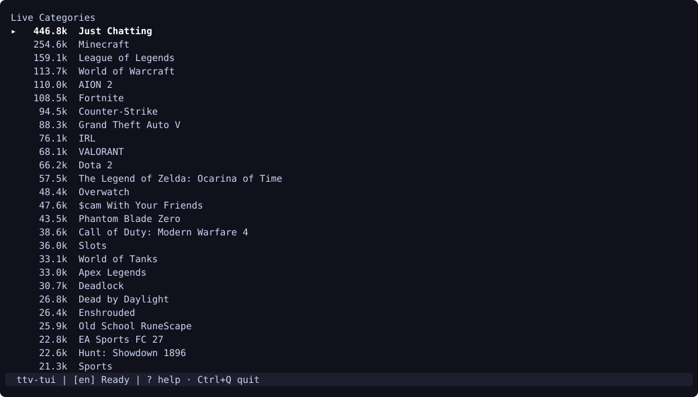
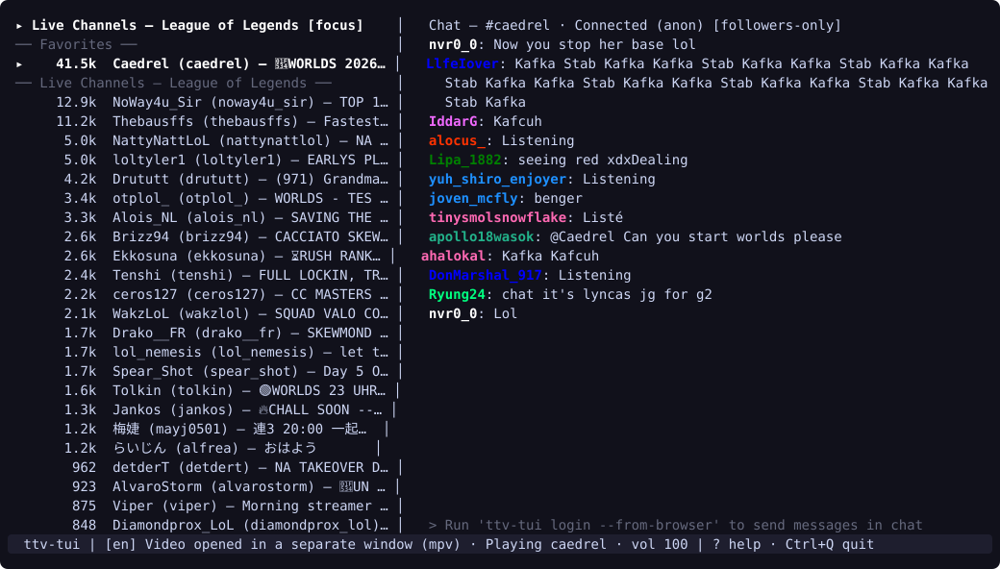
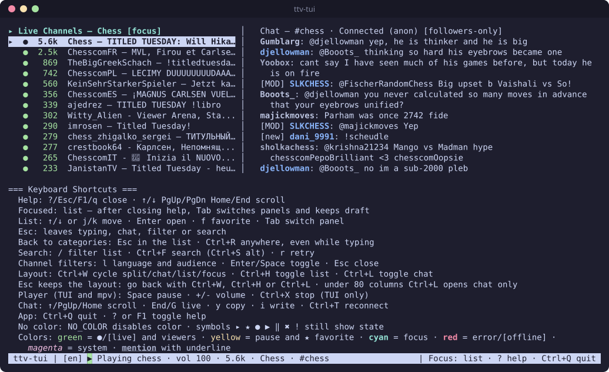
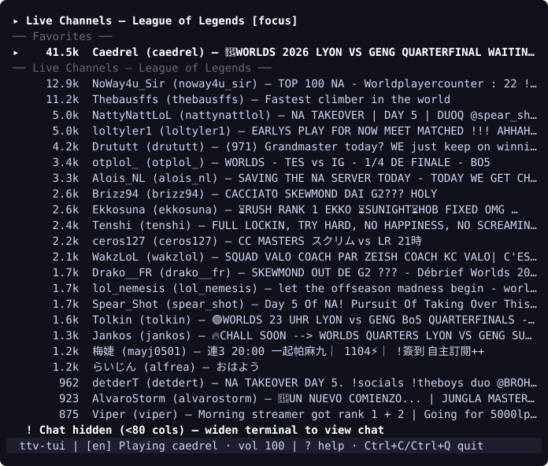

# Walkthrough

[Back to README](../README.md) · [Português (Brasil)](README.pt-BR.md)

This guide walks through a complete session with `ttv-tui` `v0.1.7` on Linux: installing the binary and its runtime tools, authenticating with your browser session, browsing categories, opening your first stream, switching channels, using chat and favorites, handling narrow terminal widths, and exiting cleanly.

## 1. Install `ttv-tui` and dependencies

Make sure `streamlink`, `mpv`, and `sqlite3` are installed on your system:

```bash
# Arch Linux
sudo pacman -S streamlink mpv sqlite libsecret

# Debian / Ubuntu
sudo apt install streamlink mpv sqlite3 libsecret-tools
```

Download the `v0.1.7` release archive for your CPU architecture (`amd64` or `arm64`), verify its SHA-256 checksum against `checksums.txt`, and unpack `ttv-tui` into `~/.local/bin`:

```bash
ARCH=amd64 # or arm64
curl -LO "https://github.com/pedrosatin/ttv-tui/releases/download/v0.1.7/ttv-tui_0.1.7_linux_${ARCH}.tar.gz"
curl -LO "https://github.com/pedrosatin/ttv-tui/releases/download/v0.1.7/checksums.txt"
sha256sum --ignore-missing -c checksums.txt

mkdir -p ~/.local/bin
tar -xzf "ttv-tui_0.1.7_linux_${ARCH}.tar.gz" -C ~/.local/bin ttv-tui
```

Verify the binary and its CLI flags:

```bash
ttv-tui --version
ttv-tui --lang en --help
```

## 2. Log in (optional, for sending chat messages)

You can browse categories, watch video streams, and read live chat anonymously without logging in. If you want to send messages in chat, import the `auth-token` cookie from a browser where you are signed into `twitch.tv`:

```bash
ttv-tui login --from-browser
```

- If only one browser profile with a cookie database is found, `ttv-tui` selects it automatically.
- If multiple profiles exist across Brave, Chrome, Chromium, Edge, Vivaldi, Opera, or Firefox, `ttv-tui` lists them and prompts you to pick one (`Choose a profile [1-N]:`), or you can pass `--browser` and `--profile` directly:

```bash
ttv-tui login --from-browser --browser firefox
```

- Alternatively, if you have a token configured in `twitch-tui` (`~/.config/twt/config.toml`), import it with:

```bash
ttv-tui login --import twt
```

`ttv-tui` validates the token against `https://id.twitch.tv/oauth2/validate` and writes it to `~/.config/ttv-tui/config.toml` with `0600` permissions.

## 3. Launch and browse live categories

Start the terminal interface:

```bash
ttv-tui
```

On startup, `ttv-tui` fetches the top live categories on Twitch sorted by concurrent viewer count:



- Use `↑` / `↓` or `j` / `k` to move the selection cursor (`▸`). Moving down to the end of the list automatically loads the next page.
- Press `/` to filter the loaded categories by name, or `Ctrl+F` to search for a channel across all of Twitch (`Ctrl+S` is an alias when the terminal is not using software flow control).
- Press `Enter` on a highlighted category (for example, `League of Legends`) to load its live channels.

## 4. Watch your first channel

Inside a category, each row displays the live viewer count, the channel display name and login (`DisplayName (login)`), and the stream title.

Press `Enter` on any channel to start watching:



Two things happen simultaneously:

1. **Video playback**: `ttv-tui` spawns `streamlink` piping the `best` quality stream into `mpv` (opened in a separate window) and connects to `mpv`'s local JSON IPC socket.
   - Press `Space` to pause or resume playback.
   - Press `+` (`=`) or `-` (`_`) to adjust `mpv` volume in 5% steps (`vol 100` in the status bar).
   - When `streamlink` filters an ad break, the status bar reports `Ad break: the video resumes on its own (Ns)` and returns to `Playing` once stream output resumes.
2. **Live chat**: the right panel opens and connects to `#<channel>` on Twitch IRC.

## 5. Switch channels and manage favorites

While a stream is playing, you can keep browsing in the left panel:

- **Favorites (`f`)**: highlight any channel in the list and press `f` to add or remove it from your Favorites. Favorited channels appear in the `── Favorites ──` section at the top of the list and persist in `~/.local/state/ttv-tui/state.json`.
- **Recent channels**: every channel you open is recorded under `── Recent ──` (up to 50 channels). When `ttv-tui` starts a new session, Favorites and Recent channels appear at the top of the list marked `[unverified]` until you open them or see them in a live list.
- **Switching channels**: highlight another channel in Favorites, Recent, or the category list and press `Enter`. `ttv-tui` terminates the previous `streamlink`/`mpv` process group, starts a new playback session for the newly selected channel, and switches the chat panel to the new channel's IRC room.
- **Returning to categories**: press `Esc` in the channel list (when no filter is active) or press `Ctrl+R` from anywhere to return to `Live Categories` while keeping the current video and chat running.
- **Stopping video only (`Ctrl+X`)**: press `Ctrl+X` to close the `mpv` window and stop `streamlink` while staying in the TUI and keeping chat open.

## 6. Read and send chat messages

- Press `Tab` to switch focus between the left list panel and the right chat panel. The focused panel shows `[focus]` in its header.
- Press `i` to start composing a message for the active channel:
  - If you are not logged in, `ttv-tui` displays a reminder to run `ttv-tui login --from-browser`.
  - When logged in, type your message and press `Enter` to send it, or `Esc` to leave input mode while keeping your draft (`Draft (i resumes): ...`).
- Each sent message shows `[sending]` until confirmed by Twitch IRC (`[sent]`), or `[rejected: <reason>]` if blocked by slow mode, followers-only, or subscribers-only restrictions.
- Press `Ctrl+T` at any time to force a chat reconnect.

Press `?` or `F1` to open the keyboard shortcuts reference at the bottom of the screen:



Press `?`, `F1`, or `Esc` to close the help overlay.

## 7. Narrow terminals (< 80 columns)

`ttv-tui` adapts its layout to the terminal width. At 80 columns or wider, the list and chat panels sit side by side. If you resize your terminal or tmux pane below 80 columns (for example, to 79 columns), `ttv-tui` hides the chat panel so the channel list stays legible and displays a notice above the status bar:



Widen the terminal back to 80 columns or more and the chat panel reappears automatically without losing buffered messages.

## 8. Quit cleanly

Press `Ctrl+Q` (even while typing in chat or filter prompts) to exit `ttv-tui`. `Ctrl+C` does not quit; it shows a hint to use `Ctrl+Q`.

On shutdown, `ttv-tui`:
1. Closes the `mpv` IPC connection.
2. Sends `SIGTERM` to the entire `streamlink`/`mpv` process group (escalating to `SIGKILL` if any process survives past the 3-second grace period).
3. Removes the temporary IPC socket directory (`$XDG_RUNTIME_DIR/ttv-tui/<gen>-*/`) and the active player registry record (`~/.local/state/ttv-tui/players/`).
4. Disconnects from Twitch IRC and restores the terminal screen.
